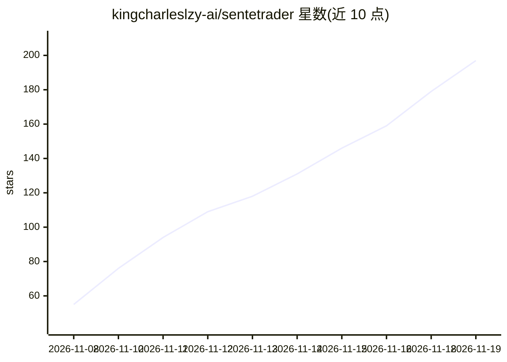

# kingcharleslzy-ai/sentetrader

⭐ 197 · Python · AGPL-3.0 · 推送 2026-11-17 · [GitHub](https://github.com/kingcharleslzy-ai/sentetrader) · [官网](https://qilinshuzhi.com/trader/download) · 组织维护 · 中文 README

**面向个人期货交易者的 AI 交易助理（模拟盘）**

面向个人期货交易者的 AI 桌面/网页应用：自动阅读交易所、部委、外电及 SMM/Mysteel 快讯并翻译筛选；用自然语言下达下单指令并经确认卡执行；让多空两个 AI 辩论后由裁判给出结论与分歧；一句话生成策略规则并回测；收盘后复盘交易习惯。提供 macOS/Windows 安装包与网页版，也支持自建版：装在本机以后台服务运行，行情用快期账号，AI 用自己的 DeepSeek 密钥（可离线演示），实盘始终关闭，AGPL-3.0 开源。

## 筛选速览

| 维度 | 判定 | 备注 |
|---|---|---|
| AI 角色 | `ai-native` | 本体是模型或模型工具 |
| 许可风险 | `viral` | AGPL-3.0 |
| 部署形态 | `desktop` | 安装包/桌面程序 |
| 模型依赖 | — | README 未给出锁定关系 |
| 硬件要求 | — | 无带数字的原话,不猜 |
| 安装摩擦 | `low` | 无编译、无系统依赖或容器化 |
| 成熟度 | — | 结构信号不足 |

## 能力要点

- 多空双 AI 辩论 + 裁判结论与改判条件机制
- 自然语言拆解为下单步骤，确认后才执行
- 一句话生成策略规则并用历史行情回测
- 支持自建版：数据与密钥仅存本机，实盘始终关闭

## 适用场景

- 让 AI 替我读新闻快讯并翻译筛选与交易相关的信息
- 用一句话下单并由确认卡逐步确认
- 把随口的交易想法变成可回测的策略规则
- 收盘后复盘每笔交易是否在计划内

## 场景标签

`金融量化` `AI 助手` · 领域:对话与助手

## 证据(README 行号)

> L6:  一个 AI 看多，一个 AI 看空，吵完再给你结论。盯盘、研究、下单、复盘，交给你自己的 AI 交易助理。
> L49: 和官方云同一套服务（行情、本站模拟成交、AI 与策略），装成后台服务，用浏览器打开。行情和模拟成交用你自己的快期账号（免费注册），AI 用你自己的 DeepSeek 密钥（可先不填，用离线演示 AI）；账号、密钥和数据都只存在你自
> L92: Sente 当前面向模拟交易账户，界面截图来自模拟账户。软件中的分析、研讨结论和回测结果均不构成投资建议，回测不代表未来表现。期货交易有风险，入市需谨慎。

## 星数曲线

2026-11-08 55 → 2026-11-19 197（+142）

---
*卡片 v1 · prompt 1.4 · 生成 2026-11-17 · 置信度 mid · 依据 README sha `2ffb84f9e38a` · [字段定义](../../DATASET.md)*
