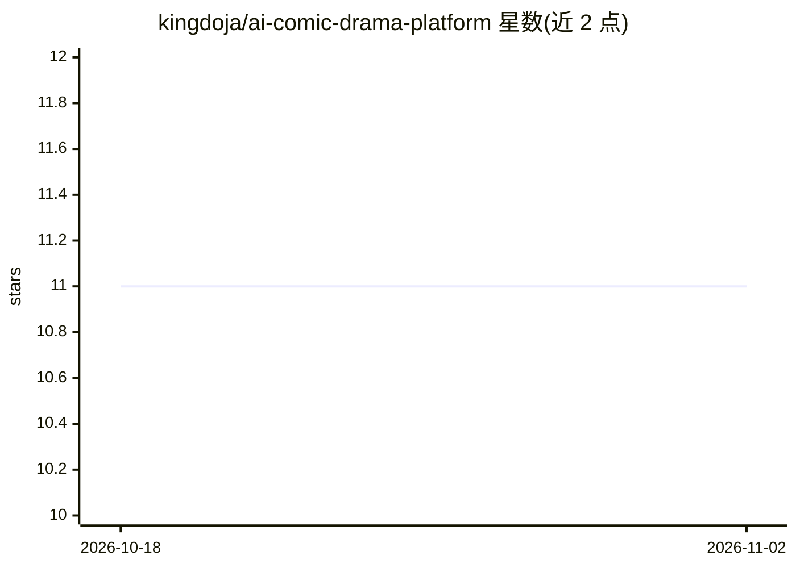

# kingdoja/ai-comic-drama-platform

⭐ 11 · Python · 推送 2026-04-12 · [GitHub](https://github.com/kingdoja/ai-comic-drama-platform) · 个人维护 · 中文 README

**将网文小说转化为竖屏漫剧分镜脚本的多 Agent 生产平台**

面向抖音、快手短视频场景的全栈 AI 漫剧生产平台，通过工作流编排器调度 5 个专业化文本 Agent（创意简报、世界观、角色、剧本、分镜），按 7 阶段流水线将中文网络小说转化为结构化竖屏分镜脚本。采用 Workflow-First 架构与 Artifact-First 状态管理，各阶段失败相互隔离、支持重试与人工审核，并提供版本化文档与锁定字段机制。后端 Python/FastAPI + PostgreSQL，前端 Next.js，基础设施含 Docker、Redis、MinIO。README 声明核心服务测试覆盖率 89%，图像生成与 TTS 集成仍在计划中，项目声明仅用于技术展示与学习交流。

## 筛选速览

| 维度 | 判定 | 备注 |
|---|---|---|
| AI 角色 | `ai-native` | 本体是模型或模型工具 |
| 许可风险 | `none` | — |
| 部署形态 | `self-host` | docker 或自建部署 |
| 模型依赖 | — | README 未给出锁定关系 |
| 硬件要求 | — | 无带数字的原话,不猜 |
| 安装摩擦 | `low` | 无编译、无系统依赖或容器化 |
| 成熟度 | `idea` | |

## 能力要点

- 工作流状态机编排 5 个文本 Agent，7 阶段标准化流水线
- 各阶段失败隔离，支持重试（最多 3 次）与从任意阶段部分重跑
- 文档版本化与锁定字段保护，防止下游 Agent 偏移
- 媒体生成管道：图像渲染、TTS、字幕生成、预览导出

## 适用场景

- 把女频言情等网文小说批量转成短视频分镜脚本
- 研究多 Agent 工作流编排与失败隔离的工程实践
- 在平台上迭代剧本、角色与分镜并做人工审核

## 场景标签

`多智能体` `AI 写作` · 领域:Agent 开发

## 证据(README 行号)

> L5: > 面向短视频平台（抖音、快手）的 AI 驱动漫剧生产平台，将网文小说转化为竖屏漫剧分镜脚本。
> L9: 这是一个全栈 AI 生产平台，通过编排多个专业化 AI Agent 来自动化从原始素材到分镜脚本的创作流程。系统展示了先进的工作流编排、Agent 架构和生产级软件工程实践。

## 星数曲线

2026-10-18 11 → 2026-11-02 11（+0）

---
*卡片 v1 · prompt 1.4 · 生成 2026-11-02 · 置信度 high · 依据 README sha `780048cd0cdc` · [字段定义](../../DATASET.md)*
