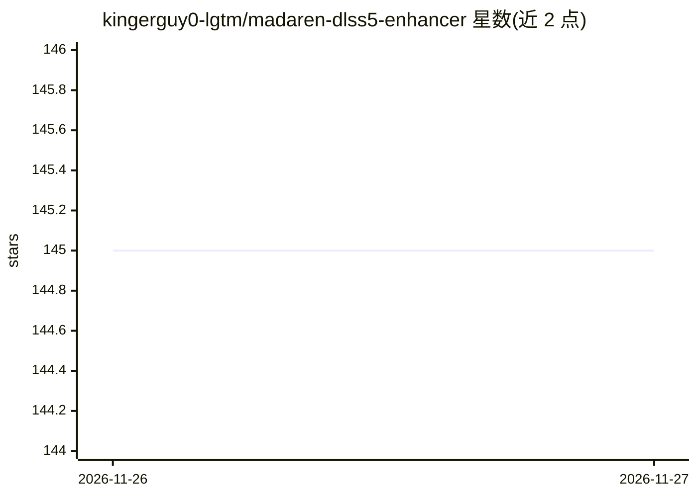

# kingerguy0-lgtm/madaren-dlss5-enhancer

⭐ 145 · HTML · 推送 2026-11-26 · [GitHub](https://github.com/kingerguy0-lgtm/madaren-dlss5-enhancer) · 个人维护

**面向游戏玩家的 DLSS5 画面调节 mod**

Windows 平台的游戏视觉增强 mod，夹在游戏渲染管线与 DLSS 5 运行时之间：按帧分析场景状态（静态/动态、亮暗），调整 DLSS 5 内部参数，提供锐化、鬼影抑制、自适应帧调度与预设库（Balanced/Quality/Cinematic）。支持按游戏独立存配置、运行中开关各增强阶段做 A/B 对比，兼容性与识别状态有明确指示。不整体替换 DLSS，仅在现有路径旁协作调整。要求 Windows 10/11 与 PowerShell，安装方式为下载压缩包手动放入游戏 mod 目录。

## 筛选速览

| 维度 | 判定 | 备注 |
|---|---|---|
| AI 角色 | `ai-enhanced` | 去掉 AI 部分产品仍成立 |
| 许可风险 | `none` | — |
| 部署形态 | `None` |  |
| 模型依赖 | — | README 未给出锁定关系 |
| 硬件要求 | — | 无带数字的原话,不猜 |
| 安装摩擦 | `low` | 无编译、无系统依赖或容器化 |
| 成熟度 | — | 结构信号不足 |

## 能力要点

- 运行中开关各增强阶段，无需重启即可 A/B 对比画面
- Balanced/Quality/Cinematic 三套内置预设，配置带注释可改
- 帧生成与超分模式解耦控制，可独立评估各自影响
- 按游戏存档的独立配置与配置回滚

## 适用场景

- 在同一游戏里对比画质档与性能档的实际效果
- 把帧生成和超分分开开关，定位卡顿来源
- 超分档位变更后单独调锐化并按游戏保存

## 场景标签

 · 领域:游戏/图形工具

## 证据(README 行号)

> L35: Madaren Dlss5 Enhancer slips between your game's render pipeline and the DLSS 5 runtime like a well-placed shunt. I
> L23: - **Tuned DLSS5 profile** — a hand-crafted preset that swaps the stock scaling curve for one built around motion cl

## 星数曲线

2026-11-26 145 → 2026-11-27 145（+0）

---
*卡片 v1 · prompt 1.4 · 生成 2026-11-26 · 置信度 mid · 依据 README sha `43b1ba88448e` · [字段定义](../../DATASET.md)*
