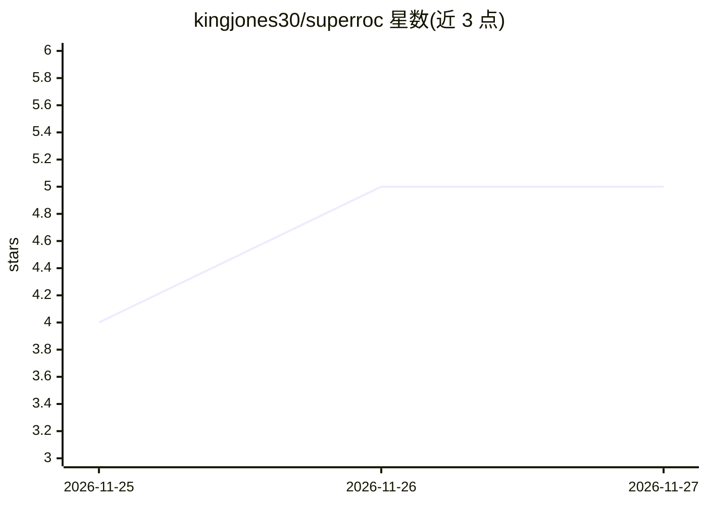

# kingjones30/superroc

⭐ 5 · C++ · MIT · 推送 2026-11-24 · [GitHub](https://github.com/kingjones30/superroc) · [官网](https://kingjones30.github.io/superroc/) · 个人维护

**面向 AMD Strix Halo 的本地 LLM 推理引擎与服务器**

Super Roc 是一个针对 AMD Strix Halo（Ryzen AI Max+ 395，gfx1151 GPU，最高 128GB 统一内存）的 LLM 推理引擎，从 MIT 许可的 ROCm 推理引擎 fork 而来。它以 GGUF 格式服务模型（含 ROCmFP4 4-bit 类型），提供 OpenAI 与 Anthropic 兼容的 API 服务器，支持 MTP/DSpark 投机解码、prompt cache 快照与多模型家族。附带 superroc-quant 量化器与随模型文件携带的 recipe 调优配置。仅支持 Linux x86-64 上的 Strix Halo 目标，需从源码或 Nix 构建。

## 筛选速览

| 维度 | 判定 | 备注 |
|---|---|---|
| AI 角色 | `ai-ecosystem` | LLM/agent 周边工具 |
| 许可风险 | `permissive` | MIT |
| 部署形态 | `None` |  |
| 模型依赖 | — | README 未给出锁定关系 |
| 硬件要求 | — | 无带数字的原话,不猜 |
| 安装摩擦 | `high` | 编译与系统依赖俱全 |
| 成熟度 | — | 结构信号不足 |

## 能力要点

- 支持 ROCmFP4/ROCmFPX 4-bit 张量类型与专用 prefill/decode 内核
- 提供 superroc-quant 独立 GGUF 量化器（多种 ROC 配方）
- OpenAI 与 Anthropic Messages 兼容 API，支持流式 SSE、工具调用与结构化输出
- 支持嵌入/侧载 MTP 头与 DSpark 投机解码，prompt cache 可从任意早前会话状态恢复

## 适用场景

- 在 Strix Halo 迷你主机上本地运行大参数 MoE 模型
- 为 Claude Code、Open WebUI、VS Code 等客户端提供本地 API 后端
- 为 ROC 平台定制 4-bit 量化模型文件

## 场景标签

`推理引擎` `模型量化` · 领域:训练与推理

## 证据(README 行号)

> L3: Super Roc is an LLM inference engine for AMD Strix Halo: Ryzen AI Max+ 395 systems with the Radeon 8060S GPU (`gfx11
> L117: Then ask it something through the OpenAI-compatible API:
> L197: Super Roc began as a fork of an MIT-licensed ROCm inference engine. The code is released under the MIT License in

## 星数曲线

2026-11-25 4 → 2026-11-27 5（+1）

---
*卡片 v1 · prompt 1.4 · 生成 2026-11-24 · 置信度 high · 依据 README sha `ba073f2b62d5` · [字段定义](../../DATASET.md)*
