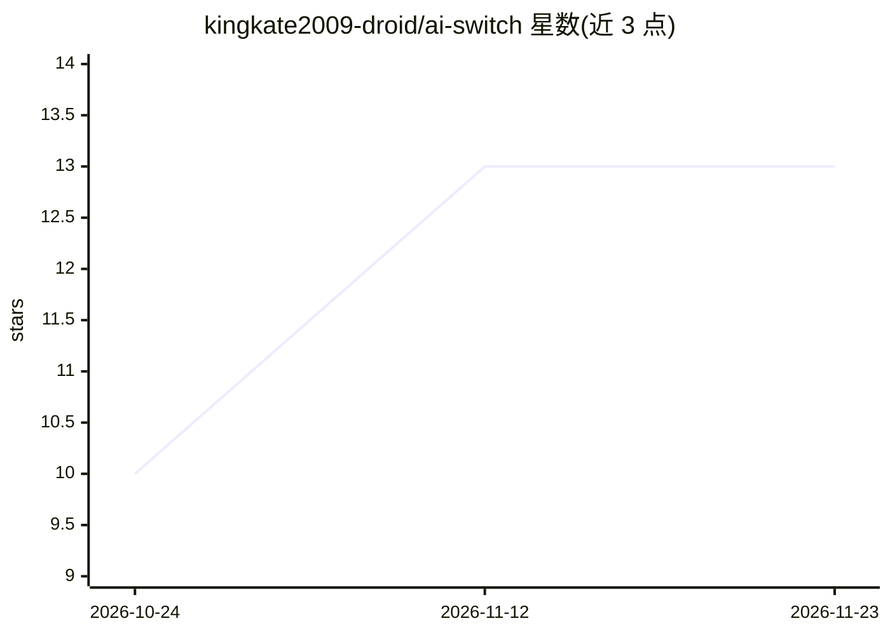

# kingkate2009-droid/ai-switch

⭐ 13 · Python · Apache-2.0 · 推送 2026-11-12 · [GitHub](https://github.com/kingkate2009-droid/ai-switch) · [官网](https://github.com/kingkate2009-droid/ai-switch/releases) · 个人维护 · 中文 README

**本地 AI Key 中枢：改一处 Key，多个 CLI 工具同步生效**

本地运行的 API Key 管理面板：集中存储中转/多厂商密钥，做健康检查、模型端点探测与质量检查，并把验证过的配置推送到已安装的命令行工具（未安装的工具不写入）。提供 19 个后端引擎适配、下游 OpenAI 兼容路由、用量统计与预算告警、飞书/Slack webhook 通知、OAuth 账号换号、磁盘加密导出与诊断报告。面向同时使用多个 AI 编程 CLI 的开发者，默认只监听 127.0.0.1，绑定外部地址时强制访问令牌。

## 筛选速览

| 维度 | 判定 | 备注 |
|---|---|---|
| AI 角色 | `ai-ecosystem` | LLM/agent 周边工具 |
| 许可风险 | `permissive` | Apache-2.0 |
| 部署形态 | `self-host` | docker 或自建部署 |
| 模型依赖 | — | README 未给出锁定关系 |
| 硬件要求 | — | 无带数字的原话,不猜 |
| 安装摩擦 | `low` | 无编译、无系统依赖或容器化 |
| 成熟度 | — | 结构信号不足 |

## 能力要点

- 一处修改 Key 后同步推送到 OpenClaw/OpenCode/Codex CLI/Claude Code 等已安装后端
- 健康检查自动剔除坏 Key，推送前有同步预览，未安装工具不写入
- 26+ 内置厂商与自定义 OpenAI 兼容端点，模型级端点探测（Chat/Responses/Messages/Gemini）
- OAuth 账号导入与换号：写入工具自身凭据存储，备份原凭据为 .bak

## 适用场景

- 同时使用多个 AI 编程 CLI，统一轮换与管理 API Key
- 中转/多厂商 Key 混用时自动探活并隔离失效 Key
- 在同一台机器的不同订阅账号间切换登录身份
- 对每日/每月用量设预算并通过飞书/Slack 接收告警

## 场景标签

`模型网关` · 领域:Agent 开发

## 证据(README 行号)

> L33: **Positioning:** a local **Key hub** (manage · probe · push) — not another chat client.
> L286: |OpenClaw|`openclaw.json`, auth profiles, models|
> L304: Endpoint support is detected per model. Automatic mode uses verified endpoints; manual mode lets you choose among 

## 星数曲线

2026-10-24 10 → 2026-11-23 13（+3）

---
*卡片 v1 · prompt 1.4 · 生成 2026-11-18 · 置信度 high · 依据 README sha `cfdb4fefce40` · [字段定义](../../DATASET.md)*
