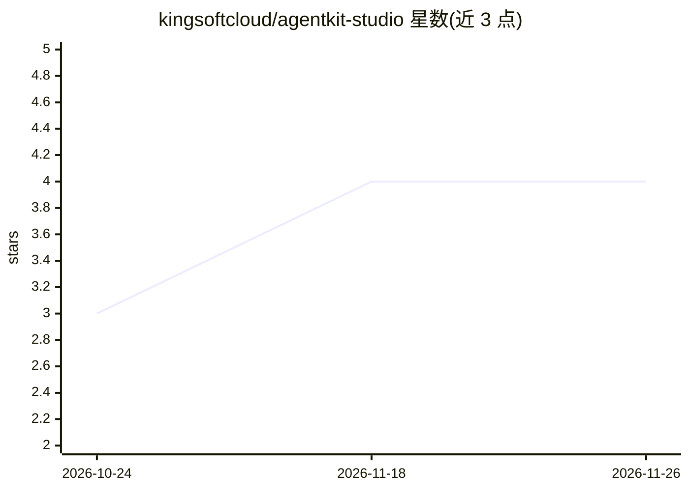

# kingsoftcloud/agentkit-studio

⭐ 4 · JavaScript · Apache-2.0 · 推送 2026-11-25 · [GitHub](https://github.com/kingsoftcloud/agentkit-studio) · [官网](https://kingsoftcloud.github.io/agentkit-studio/) · 组织维护 · 中文 README

**面向开发者的 DeepSeek Harness Agent 编排与部署工作台**

作为公共 DeepSeek Harness 主机的产品插件，提供 Agent 编写（含修订版管理，绑定模型、MCP、Skill、知识与记忆）、资源发现与生命周期管理、本地对话、构建与部署控制、自动化及插件发现，覆盖 Harness Web 与 macOS/Windows 桌面端。仓库仅包含 Studio 代码、兼容性补丁与打包脚本，须配合 CONTRIBUTING.md 声明的固定版本 DSH 主机运行，不含 DSH 源码树与用户凭据；云功能需配置 AgentEngine 控制平面与凭据。文档站提供中英双语页面。

## 筛选速览

| 维度 | 判定 | 备注 |
|---|---|---|
| AI 角色 | `ai-ecosystem` | LLM/agent 周边工具 |
| 许可风险 | `permissive` | Apache-2.0 |
| 部署形态 | `library` | 以包/库形式分发 |
| 模型依赖 | locked-api |  |
| 硬件要求 | — | 无带数字的原话,不猜 |
| 安装摩擦 | `low` | 无编译、无系统依赖或容器化 |
| 成熟度 | — | 结构信号不足 |

## 能力要点

- Agent 创建与修订版编辑，支持模型/MCP/Skill/知识/记忆绑定
- 面向 Studio、Codex、Star Harness 三种运行时的原生 DSH 对话
- DSH 插件发现与官方捆绑包及安装后能力检查
- 桌面端含运行时统计的独立隐私控制

## 适用场景

- 在 Harness 上编排和管理多个 Agent 及其资源绑定
- 将 Agent 构建产物部署到云端或本地主机
- 浏览与安装经过策展的 DSH 插件市场

## 场景标签

`Agent 框架` · 领域:Agent 开发

## 证据(README 行号)

> L5: AgentKit Studio is a product plugin for the public DeepSeek Harness host. It provides Agent authoring, resource mana
> L16: - Build, deployment, automation, channel, and operational surfaces through typed Host APIs.

## 星数曲线

2026-10-24 3 → 2026-11-26 4（+1）

---
*卡片 v1 · prompt 1.4 · 生成 2026-11-21 · 置信度 mid · 依据 README sha `c7dd29bca1c9` · [字段定义](../../DATASET.md)*
