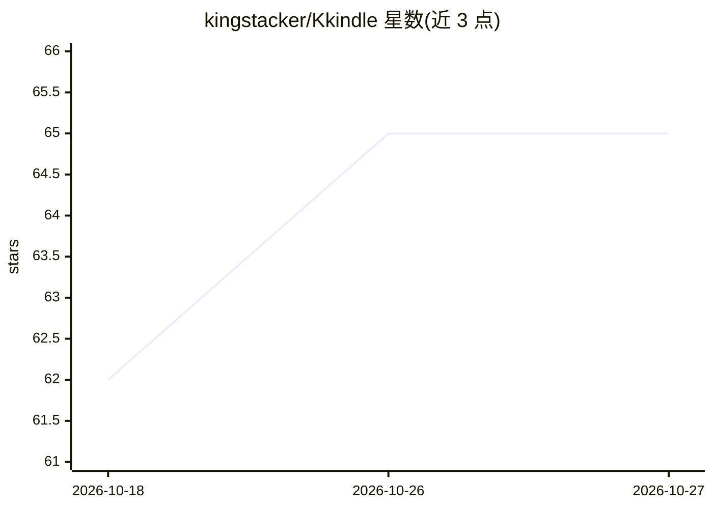

# kingstacker/Kkindle

⭐ 65 · C# · GPL-3.0 · 推送 2026-10-26 · [GitHub](https://github.com/kingstacker/Kkindle) · [官网](https://kkindle.stacker.beauty/) · 个人维护 · 中文 README

**跨平台电子书与 Kindle 管理桌面应用，带 AI 助手**

基于 Avalonia 的桌面应用，面向 Windows/Linux/macOS 用户，整合本地书库管理、EPUB/PDF/AZW3 阅读、批注、TXT 自动转 EPUB、Kindle USB/WPD/MTP 设备传输与剪贴导入，以及可选的 Calibre 格式转换和 S3/WebDAV 同步。AI 部分为针对当前书籍的问答、章节摘要与选段解释，通过 DeepSeek、OpenAI 或兼容端点选择已发现的模型，请求仅使用相关本地摘录。macOS 包已提供但目标设备验证仍在进行。

## 筛选速览

| 维度 | 判定 | 备注 |
|---|---|---|
| AI 角色 | `ai-enhanced` | 去掉 AI 部分产品仍成立 |
| 许可风险 | `viral` | GPL-3.0 |
| 部署形态 | `None` |  |
| 模型依赖 | locked-api |  |
| 硬件要求 | — | 无带数字的原话,不猜 |
| 安装摩擦 | `medium` | 含编译或系统依赖之一 |
| 成熟度 | — | 结构信号不足 |

## 能力要点

- TXT 编码与章节自动检测并转 EPUB，无需 Calibre
- 内置 KF8 阅读器可直接打开 DRM-free AZW3
- AI 助手支持当前书籍问答/摘要，经 DeepSeek、OpenAI 或兼容端点
- Kindle 设备检测、传输与 My Clippings.txt 导入

## 适用场景

- 在桌面端统一管理、阅读和批注电子书
- 把书库与批注经 S3/WebDAV 在多设备同步
- 向 AI 询问当前所读书籍的内容或生成章节摘要
- 向 Kindle 设备传书并管理字体与词典

## 场景标签

`文档问答` · 领域:知识与检索

## 证据(README 行号)

> L9: Kkindle is a quiet, cross-platform ebook and Kindle manager built with Avalonia. It combines a local library, readin
> L18: - **AI assistant** — Ask questions about the current book, summarize chapters, explain selections, and choose from 

## 星数曲线

2026-10-18 62 → 2026-10-27 65（+3）

---
*卡片 v1 · prompt 1.4 · 生成 2026-10-24 · 置信度 high · 依据 README sha `b79b10df4ab1` · [字段定义](../../DATASET.md)*
