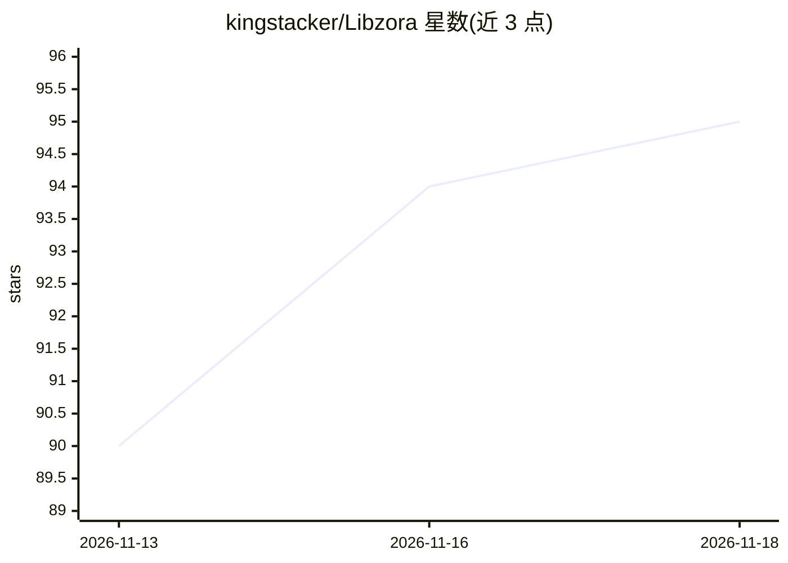

# kingstacker/Libzora

⭐ 95 · C# · GPL-3.0 · 推送 2026-11-17 · [GitHub](https://github.com/kingstacker/Libzora) · [官网](https://kkindle.stacker.beauty/) · 组织维护 · 中文 README

**跨平台电子书与 Kindle 管理阅读器，含 AI 助手**

基于 Avalonia 的桌面应用（Windows/macOS/Linux，移动端开发中），集成本地书库、EPUB/PDF/DRM-free AZW3 阅读、批注、格式转换与 USB Kindle 传输。AI 助手可对当前书提问、总结章节、解释选段，通过 DeepSeek、OpenAI 或兼容端点接入，请求仅使用相关本地摘录。跨设备同步走用户自有 S3/WebDAV，无需账号；当前版本免费，规划中的账号服务分 Free/Trial/¥88 Lifetime 三档。GPL-3.0 许可。

## 筛选速览

| 维度 | 判定 | 备注 |
|---|---|---|
| AI 角色 | `ai-enhanced` | 去掉 AI 部分产品仍成立 |
| 许可风险 | `viral` | GPL-3.0 |
| 部署形态 | `None` |  |
| 模型依赖 | locked-api |  |
| 硬件要求 | — | 无带数字的原话,不猜 |
| 安装摩擦 | `medium` | 含编译或系统依赖之一 |
| 成熟度 | `idea` | |

## 能力要点

- 导入 EPUB/PDF/MOBI/AZW3/TXT，TXT 自动检测编码与章节并转 EPUB（无需 Calibre）
- AI 助手支持对当前书提问、章节总结与选段解释，可接 DeepSeek/OpenAI 及兼容端点
- 检测 USB/WPD/MTP Kindle 设备，传书、管理字体词典并导入 My Clippings.txt
- 用自有 S3/WebDAV 做加密跨设备同步，当前无需账号

## 适用场景

- 管理本地电子书库并跨 Windows/macOS/Linux 阅读
- 通过 USB 向 Kindle 传输书籍并导入标注
- 阅读时让 AI 总结章节或解释选中内容

## 场景标签

`文档问答` · 领域:知识与检索

## 证据(README 行号)

> L9: Libzora is a quiet, cross-platform ebook and Kindle manager built with Avalonia. It combines a local library, readin
> L37: - **AI assistant** — Ask questions about the current book, summarize chapters, explain selections, and choose from 

## 星数曲线

2026-11-13 90 → 2026-11-18 95（+5）

---
*卡片 v1 · prompt 1.4 · 生成 2026-11-17 · 置信度 high · 依据 README sha `63118fd79ad1` · [字段定义](../../DATASET.md)*
