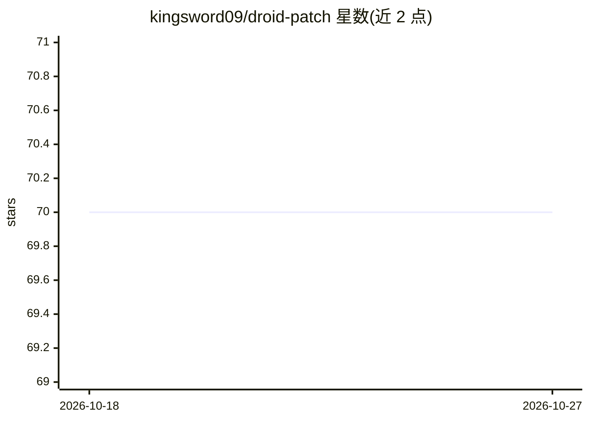

# kingsword09/droid-patch

⭐ 70 · TypeScript · MIT · 推送 2026-08-11 · [GitHub](https://github.com/kingsword09/droid-patch) · [官网](https://www.npmjs.com/package/droid-patch) · 个人维护 · 中文 README

**droid 二进制补丁 CLI：为自定义模型解锁登录/联网/推理等功能**

面向 Factory droid 编码代理的 Node.js CLI 工具，通过在二进制中查找并等长替换字节模式实施补丁：为自定义模型开启上下文压缩、注入伪 FACTORY_API_KEY 跳过登录、替换 API 地址、启用推理力度 UI 选择器、禁用遥测。联网方面支持外部搜索商（Smithery/Google PSE/Tavily/Serper/Brave/SearXNG/DuckDuckGo）经本地代理接入，或走 Anthropic/OpenAI 原生 web_search（需 jixoai/proxy 插件）。standalone 模式本地 mock 非 LLM Factory API 以实现除 LLM 调用外的本地运行。限制：独立模式 API URL 需 ≤22 字符；is-custom 补丁副作用未知。

## 筛选速览

| 维度 | 判定 | 备注 |
|---|---|---|
| AI 角色 | `ai-ecosystem` | LLM/agent 周边工具 |
| 许可风险 | `permissive` | MIT |
| 部署形态 | `self-host` | docker 或自建部署 |
| 模型依赖 | — | README 未给出锁定关系 |
| 硬件要求 | — | 无带数字的原话,不猜 |
| 安装摩擦 | `low` | 无编译、无系统依赖或容器化 |
| 成熟度 | — | 结构信号不足 |

## 能力要点

- 字节级补丁机制：查找特定模式并等长替换，macOS 自动 codesign 重签名
- 外部搜索商模式含 7 家 provider 自动降级，每实例独立代理端口
- standalone 模式白名单转发 LLM API、本地 mock 其余 Factory API
- 别名系统记录补丁元数据，droid 更新后可一键重放全部补丁

## 适用场景

- 让 droid 使用自定义模型/本地代理后端
- 跳过登录并禁用遥测与 Sentry 上报
- 为自定义模型启用推理力度选择与原生 web_search

## 场景标签

 · 领域:开发者工具/AI 代理配置

## 证据(README 行号)

> L5: CLI tool to patch the droid binary with various modifications.
> L41: |`--skip-login`|Bypass login by injecting a fake `FACTORY_API_KEY` into the binary|
> L191: - **Multiple search providers** with automatic fallback (Smithery > Google PSE > Tavily > Serper > Brave > SearXNG

## 星数曲线

2026-10-18 70 → 2026-10-27 70（+0）

---
*卡片 v1 · prompt 1.4 · 生成 2026-10-24 · 置信度 mid · 依据 README sha `46a53e231175` · [字段定义](../../DATASET.md)*
