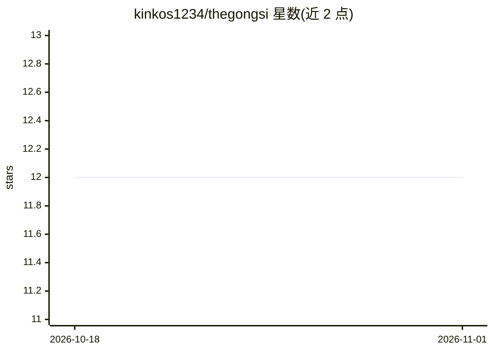

# kinkos1234/thegongsi

⭐ 12 · Python · MIT · 推送 2026-05-02 · [GitHub](https://github.com/kinkos1234/thegongsi) · [官网](https://thegongsi.vercel.app) · 个人维护

**面向韩国个人投资者的 DART 公告 AI 研究终端**

围绕韩国 DART 电子公示系统构建的开源 AI 研究终端：跟踪自选股公告并提供韩语自动摘要、异常征兆分级标记、AI DD 备忘录，并基于 Neo4j 企业实体图提供 GraphRAG 自然语言问答（供应链、竞争关系、支配结构），支持自动 Cypher 生成与 LLM 关系抽取。后端 FastAPI + PostgreSQL + Neo4j，前端 Next.js，LLM 通过 Anthropic Claude BYOK 接入。声明 AI 备忘录仅为参考资料，不提供目标价或买卖推荐。

## 筛选速览

| 维度 | 判定 | 备注 |
|---|---|---|
| AI 角色 | `ai-native` | 本体是模型或模型工具 |
| 许可风险 | `permissive` | MIT |
| 部署形态 | `self-host` | docker 或自建部署 |
| 模型依赖 | locked-api |  |
| 硬件要求 | — | 无带数字的原话,不猜 |
| 安装摩擦 | `low` | 无编译、无系统依赖或容器化 |
| 成熟度 | — | 结构信号不足 |

## 能力要点

- DART 公告韩语自动摘要与异常征兆 severity 分级标记
- GraphRAG 自然语言问答（供应链/支配结构图，自动生成 Cypher）
- AI DD 备忘录（bull/bear/thesis，含版本历史）
- LLM 每周从 DART 公告正文自动抽取供应链关系（41 类 187 条边）

## 适用场景

- 跟踪我持有的韩国股票的重要公告与异常信号
- 用自然语言查询公司间的供应链与股权关系
- 生成并维护某只股票的 bull/bear 尽调备忘录

## 场景标签

`金融量化` `知识图谱` · 领域:知识与检索

## 证据(README 行号)

> L12: > Korean listed companies file ~1M disclosures per year on DART (the national electronic filing system, like SEC ED
> L30: - **DART 공시 AI 분석** — 자동 한국어 요약 + 이상징후 severity(low/med/high) 플래그.
> L31: - **AI DD 메모** — 종목 → bull/bear/thesis 한국어 메모(공시+뉴스+실적 통합, 버전 히스토리).

## 星数曲线

2026-10-18 12 → 2026-11-01 12（+0）

---
*卡片 v1 · prompt 1.4 · 生成 2026-11-01 · 置信度 mid · 依据 README sha `2d815be7e5e6` · [字段定义](../../DATASET.md)*
