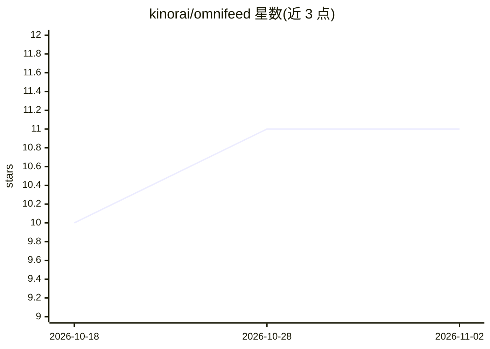

# kinorai/omnifeed

⭐ 11 · Go · MIT · 推送 2026-11-01 · [GitHub](https://github.com/kinorai/omnifeed) · [官网](https://kinorai.github.io/omnifeed/) · 个人维护

**自托管 web 搜索+抓取 MCP 服务，含专用 Reddit 引擎**

面向 AI agent 的自托管研究工具：在自建 SearXNG 与 crawl4ai 上提供 web_search 与 fetch_url 两个 MCP 工具，完成搜索→URL→内容的完整研究闭环。Reddit 引擎通过真实浏览器/OAuth 返回完整评论树，输出 TOON 格式；Hacker News、GitHub、Bluesky、Discourse、X/Twitter 亦有专用引擎。前端支持 MCP（HTTP/stdio）、Open WebUI 与 REST；以 docker compose 部署，tokenless 开箱可用，多副本需 Redis 共享限流状态。

## 筛选速览

| 维度 | 判定 | 备注 |
|---|---|---|
| AI 角色 | `ai-ecosystem` | LLM/agent 周边工具 |
| 许可风险 | `permissive` | MIT |
| 部署形态 | `self-host` | docker 或自建部署 |
| 模型依赖 | — | README 未给出锁定关系 |
| 硬件要求 | — | 无带数字的原话,不猜 |
| 安装摩擦 | `low` | 无编译、无系统依赖或容器化 |
| 成熟度 | — | 结构信号不足 |

## 能力要点

- 搜索（SearXNG+TinyFish 备援）与抓取（crawl4ai）合一的自托管服务
- Reddit 完整评论树（最多约4k条）输出 TOON，无 JSON 冗余且无需 Reddit API key
- MCP / Open WebUI / REST 三种前端，兼容 Claude Code、Cursor、Codex 等客户端
- Prometheus 指标、OpenTelemetry 追踪、Bearer token 认证

## 适用场景

- 给 Claude Code/Cursor 等 MCP 客户端接入联网搜索与网页抓取
- 让 agent 获取 Reddit 完整评论树做研究
- 作为 Open WebUI 的外部 web loader 引擎

## 场景标签

`网页抓取` · 领域:效率与自动化

## 证据(README 行号)

> L9: omnifeed gives an AI agent the full research loop, search → URLs → content , on self-hosted
> L44: ### As an MCP server
> L78: **`fetch_url`** is always available. **`web_search`** appears only when a searcher is configured: `OMNIFEED_SEARXNG

## 星数曲线

2026-10-18 10 → 2026-11-02 11（+1）

---
*卡片 v1 · prompt 1.4 · 生成 2026-11-02 · 置信度 high · 依据 README sha `3a12f7fd3ce4` · [字段定义](../../DATASET.md)*
