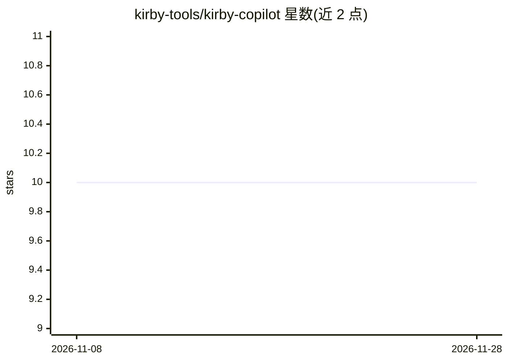

# kirby-tools/kirby-copilot

⭐ 10 · PHP · NOASSERTION · 推送 2026-11-27 · [GitHub](https://github.com/kirby-tools/kirby-copilot) · [官网](https://kirby.tools/copilot) · 个人维护

**Kirby CMS 的 AI 辅助插件，支持面板生成与 MCP 接入**

为 Kirby CMS 提供的付费插件，在 Panel 中接入 AI：可按 blueprint 选择视图按钮、工具栏、内联建议、字段等交互面，也可通过 PHP API 从 CLI/hook 驱动同一 provider 栈。支持 OpenAI、Anthropic、Google、Mistral 多后端切换，Claude 或 ChatGPT 等 agent 可经 MCP 准备修改，默认需在 Panel 中人工发布。需 Kirby 6，生产环境需购买许可，本地可无许可测试。

## 筛选速览

| 维度 | 判定 | 备注 |
|---|---|---|
| AI 角色 | `ai-enhanced` | 去掉 AI 部分产品仍成立 |
| 许可风险 | `none` | NOASSERTION |
| 部署形态 | `None` |  |
| 模型依赖 | locked-api |  |
| 硬件要求 | — | 无带数字的原话,不猜 |
| 安装摩擦 | `low` | 无编译、无系统依赖或容器化 |
| 成熟度 | — | 结构信号不足 |

## 能力要点

- 多 provider 支持：OpenAI、Anthropic、Google、Mistral 可随时切换
- Agent 经 MCP 准备修改，默认等待用户在 Panel 中发布
- PHP API 可从 CLI、hooks 与自定义工作流调用 AI
- Skills 可复用指令，通过 @skill:// 引入任意提示

## 适用场景

- 在 Kirby CMS 后台用一个提示填充多个字段
- 在 writer/textarea 字段中重写或扩写选中文本
- 让 Claude/ChatGPT 等 agent 经 MCP 准备内容修改后人工发布

## 场景标签

`AI 助手` `AI 写作` · 领域:对话与助手

## 证据(README 行号)

> L5: Kirby Copilot is a plugin for Kirby CMS that brings AI assistance into the Panel without forcing a workflow. Pick th
> L24: Kirby Copilot is a commercial plugin that requires a license. You can install and test the plugin locally without a

## 星数曲线

2026-11-08 10 → 2026-11-28 10（+0）

---
*卡片 v1 · prompt 1.4 · 生成 2026-11-19 · 置信度 high · 依据 README sha `39ac98088173` · [字段定义](../../DATASET.md)*
