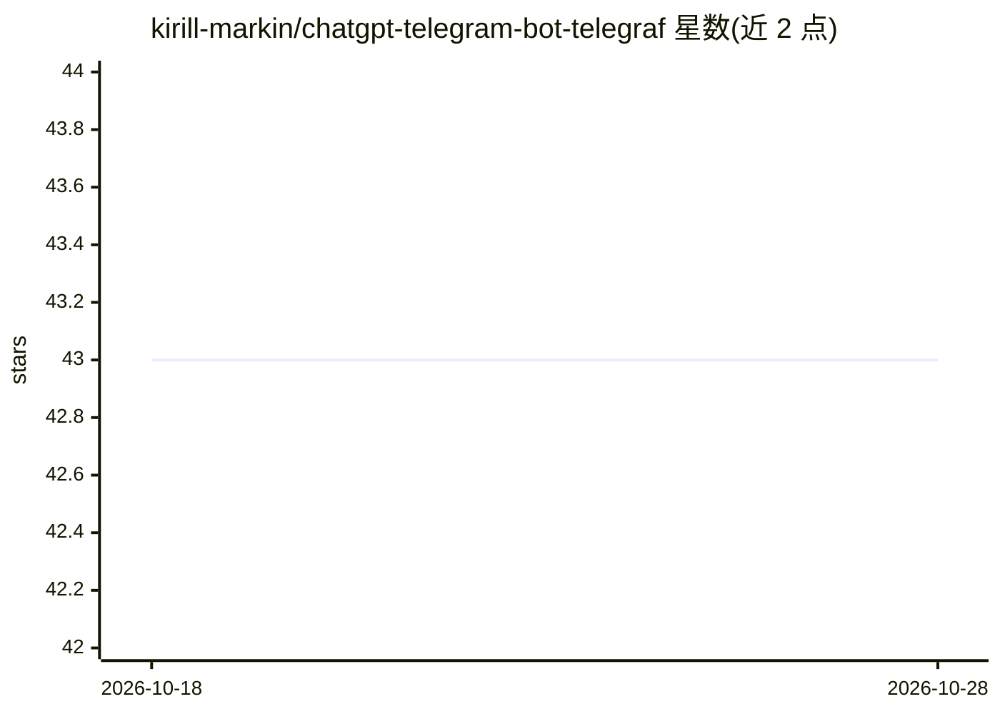

# kirill-markin/chatgpt-telegram-bot-telegraf

⭐ 43 · TypeScript · MIT · 推送 2026-10-23 · [GitHub](https://github.com/kirill-markin/chatgpt-telegram-bot-telegraf) · [官网](https://t.me/chat_gpt_ai_open_source_bot) · 个人维护

**开源 ChatGPT Telegram 机器人，支持文字/语音/图片问答**

基于 Telegraf 框架构建的 Telegram 机器人，用户通过文字、语音消息和图片向 OpenAI ChatGPT 提问并获得文本回复；语音与图片先转换为文本再处理。使用 PostgreSQL 存储用户与消息数据，可选接入 Pinecone 向量数据库提供长期记忆、接入 Perplexity AI 增强搜索。提供 Docker/Docker Compose 部署与 Heroku/Render/Railway 一键部署按钮，本地运行需 Node.js、npm、PostgreSQL 与 OpenAI API key；另含 PREMIUM 用户管理与测试命令。

## 筛选速览

| 维度 | 判定 | 备注 |
|---|---|---|
| AI 角色 | `ai-native` | 本体是模型或模型工具 |
| 许可风险 | `permissive` | MIT |
| 部署形态 | `self-host` | docker 或自建部署 |
| 模型依赖 | — | README 未给出锁定关系 |
| 硬件要求 | — | 无带数字的原话,不猜 |
| 安装摩擦 | `low` | 无编译、无系统依赖或容器化 |
| 成熟度 | — | 结构信号不足 |

## 能力要点

- 文字/语音/图片消息统一转为 ChatGPT 文本回复
- 可选 Pinecone 向量库提供长期记忆
- 可选 Perplexity AI 增强搜索
- Docker Compose 部署与 Heroku/Render/Railway 一键部署按钮

## 适用场景

- 在 Telegram 中通过文字、语音或图片向 ChatGPT 提问
- 为社群或客服场景部署 AI 对话机器人
- 利用长期记忆提升多轮对话回答质量

## 场景标签

`聊天机器人` · 领域:对话与助手

## 证据(README 行号)

> L3: Open source ChatGPT Telegram Bot via Telegraf is an advanced Telegram bot designed to provide seamless text, voice, 
> L19: - **Text Message Processing**: Handles text messages, converting them to responses.
> L22: - **OpenAI's ChatGPT Integration**: Utilizes the powerful ChatGPT model to generate responses.

## 星数曲线

2026-10-18 43 → 2026-10-28 43（+0）

---
*卡片 v1 · prompt 1.4 · 生成 2026-10-25 · 置信度 high · 依据 README sha `c2118ea5963d` · [字段定义](../../DATASET.md)*
