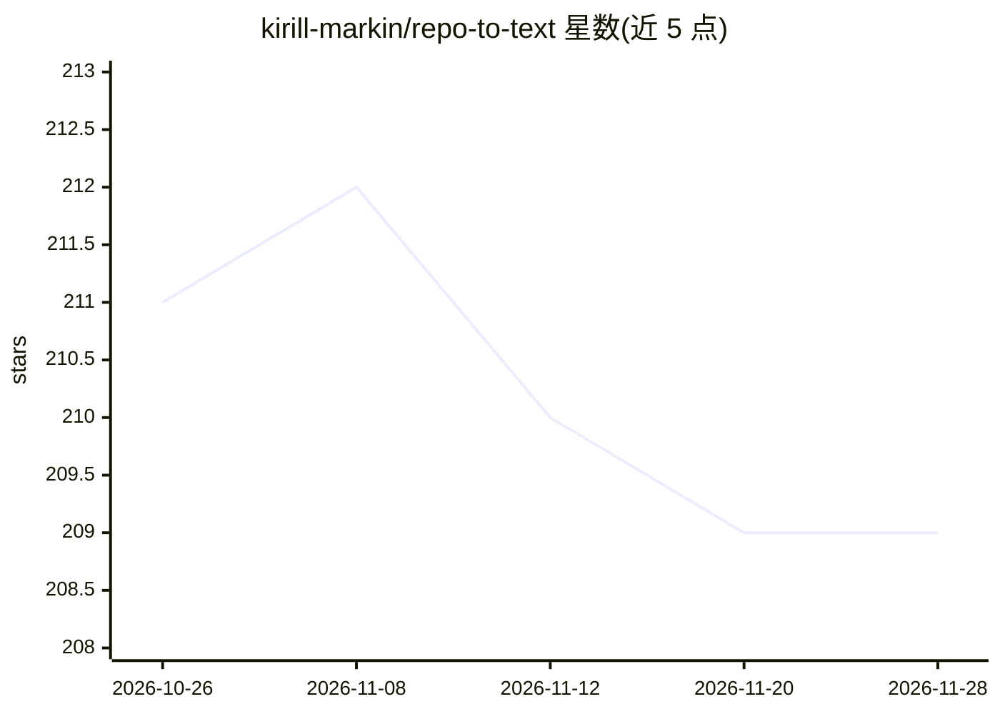

# kirill-markin/repo-to-text

⭐ 209 · Python · MIT · 推送 2026-11-21 · [GitHub](https://github.com/kirill-markin/repo-to-text) · [官网](https://pypi.org/project/repo-to-text/) · 个人维护

**把代码仓库转成单个文本文件，便于与 LLM 讨论代码**

一个 Python 命令行工具，将目录结构与文件内容转换为单一文本文件：包含目录树和以 XML 标签组织的文件内容，结果自动复制到剪贴板。支持通过 YAML 配置文件按 gitignore 规则自定义忽略项（含通配符与排除规则）、按最大词数拆分输出文件、stdout 重定向、指定输出目录，以及 Docker Compose 方式运行。面向需要把代码库内容交给 LLM 进行开发与调试的开发者，依赖 Python 与 git。

## 筛选速览

| 维度 | 判定 | 备注 |
|---|---|---|
| AI 角色 | `ai-ecosystem` | LLM/agent 周边工具 |
| 许可风险 | `permissive` | MIT |
| 部署形态 | `self-host` | docker 或自建部署 |
| 模型依赖 | — | README 未给出锁定关系 |
| 硬件要求 | — | 无带数字的原话,不猜 |
| 安装摩擦 | `low` | 无编译、无系统依赖或容器化 |
| 成熟度 | — | 结构信号不足 |

## 能力要点

- repo-to-text/flatten 命令一键生成含目录树与文件内容的文本，并复制到剪贴板
- YAML 设置文件支持 gitignore 规则、通配符与分段忽略配置
- 支持按最大词数拆分为多个输出文件
- 提供 Docker Compose 运行方式与 --stdout 管道输出

## 适用场景

- 把整个代码库打包成文本发给 LLM 进行开发与调试
- 自定义忽略规则后生成项目文档文本
- 通过管道将仓库文本输出传递给其他命令

## 场景标签

 · 领域:开发者工具/LLM 辅助开发

## 证据(README 行号)

> L3: `repo-to-text` converts a directory's structure and contents into a single text file. Run it from the terminal to ge
> L46: This will create a file named `repo-to-text_YYYY-MM-DD-HH-MM-SS-UTC.txt` in the current directory with the text rep

## 星数曲线

2026-10-26 211 → 2026-11-28 209（-2）

---
*卡片 v1 · prompt 1.4 · 生成 2026-11-25 · 置信度 high · 依据 README sha `08b5457b58db` · [字段定义](../../DATASET.md)*
