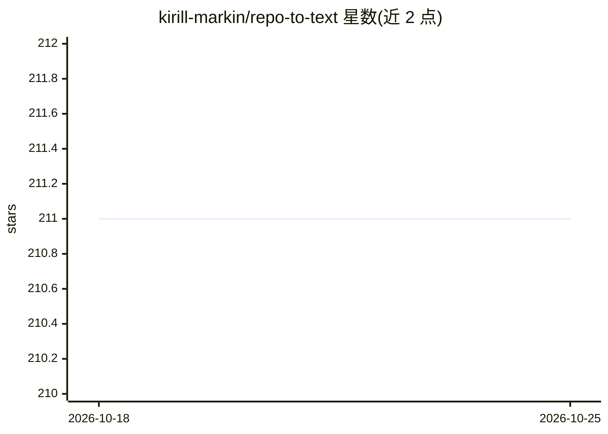

# kirill-markin/repo-to-text

⭐ 211 · Python · MIT · 推送 2026-10-23 · [GitHub](https://github.com/kirill-markin/repo-to-text) · [官网](https://pypi.org/project/repo-to-text/) · 个人维护

**把仓库目录树与文件内容转成单个文本文件，便于分享给 LLM**

Python 命令行工具，在仓库目录下运行后生成带时间戳的文本文件：包含目录树与各文件内容，使用 XML 标签组织结构，并复制到剪贴板便于分享给 LLM 讨论代码。支持通过 gitignore 规则与通配符配置忽略项、按最大字数拆分输出、输出到 stdout 或指定目录，另提供 Docker Compose 运行方式与开发安装路径。

## 筛选速览

| 维度 | 判定 | 备注 |
|---|---|---|
| AI 角色 | `ai-ecosystem` | LLM/agent 周边工具 |
| 许可风险 | `permissive` | MIT |
| 部署形态 | `self-host` | docker 或自建部署 |
| 模型依赖 | — | README 未给出锁定关系 |
| 硬件要求 | — | 无带数字的原话,不猜 |
| 安装摩擦 | `low` | 无编译、无系统依赖或容器化 |
| 成熟度 | — | 结构信号不足 |

## 能力要点

- 生成含目录树与文件内容的单文件，用 XML 标签组织结构
- 输出自动复制到剪贴板
- 通过 YAML 设置文件支持 gitignore 规则、通配符忽略与按字数拆分
- 提供 Docker Compose 容器运行方式

## 适用场景

- 把整个代码仓库打包成文本交给 LLM 做开发或调试讨论
- 通过管道将仓库文本输出给其他命令处理
- 按规则排除敏感或无关文件后生成精简版仓库文本

## 场景标签

 · 领域:开发者工具/LLM 辅助

## 证据(README 行号)

> L3: `repo-to-text` converts a directory's structure and contents into a single text file. Run it from the terminal to ge
> L15: The generated text file will include the directory structure and contents of each file, using XML tags for better s

## 星数曲线

2026-10-18 211 → 2026-10-25 211（+0）

---
*卡片 v1 · prompt 1.4 · 生成 2026-10-22 · 置信度 high · 依据 README sha `a6aa50c64d02` · [字段定义](../../DATASET.md)*
