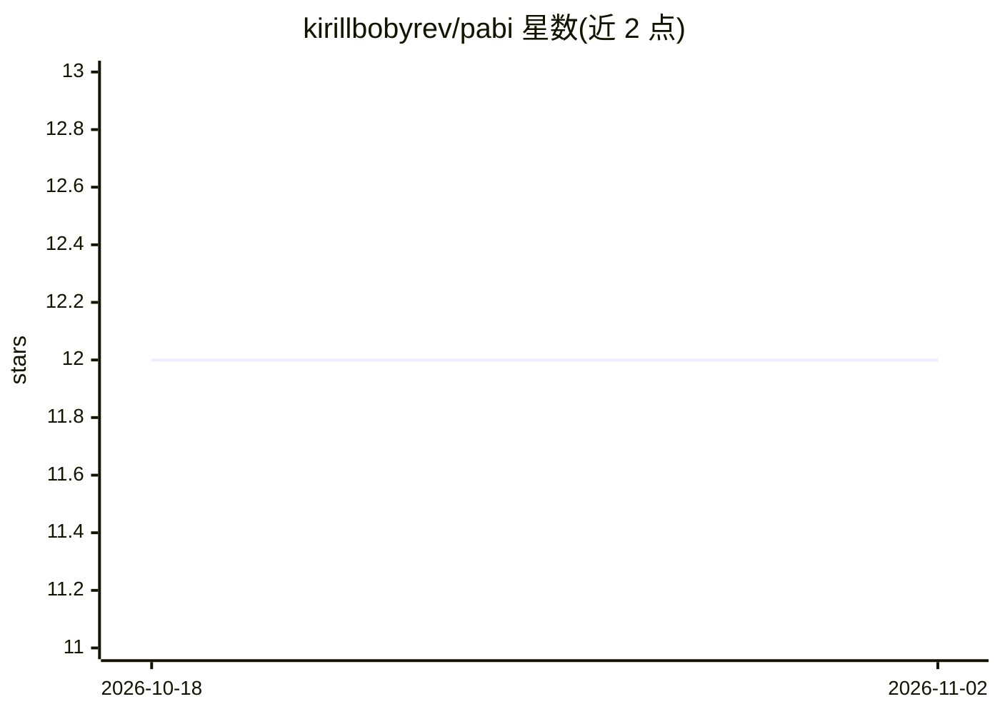

# kirillbobyrev/pabi

⭐ 12 · Rust · GPL-3.0 · 推送 2026-07-21 · [GitHub](https://github.com/kirillbobyrev/pabi) · 个人维护

**Rust 编写的 MCTS 国际象棋引擎（开发中）**

Pabi 是一个用 Rust 编写的国际象棋引擎，受 lc0 与 KataGo 等 Chess/Go 引擎及其所基于的 AlphaZero、MuZero、MCTS 研究启发。目标包括进入顶级引擎榜单并参加 TCEC、CCC 等赛事，当前处于早期开发阶段，README 明确声明尚不可用。开发流程通过 just 管理构建、测试、检查与模糊测试命令，里程碑中 PoC、Stable、Strong 均未达成。

## 筛选速览

| 维度 | 判定 | 备注 |
|---|---|---|
| AI 角色 | `ai-native` | 本体是模型或模型工具 |
| 许可风险 | `viral` | GPL-3.0 |
| 部署形态 | `None` |  |
| 模型依赖 | — | README 未给出锁定关系 |
| 硬件要求 | — | 无带数字的原话,不猜 |
| 安装摩擦 | `low` | 无编译、无系统依赖或容器化 |
| 成熟度 | `idea` | |

## 能力要点

- 基于 AlphaZero/MuZero/MCTS 研究思路的引擎实现
- Rust 语言编写，通过 just 管理常用开发命令
- 提供在线代码文档导航

## 适用场景

- 研究 MCTS/强化学习在棋类引擎中的实现
- 跟踪一个尚处早期阶段的现代象棋引擎项目
- 以 Rust 学习引擎工程实践

## 场景标签

 · 领域:游戏 AI/棋类引擎

## 证据(README 行号)

> L18: Pabi is inspired by existing Chess and Go engines (mainly [lc0] and [KataGo]),
> L19: and the research that they are based on ([AlphaZero], [MuZero] and [MCTS]). Pabi

## 星数曲线

2026-10-18 12 → 2026-11-02 12（+0）

---
*卡片 v1 · prompt 1.4 · 生成 2026-11-01 · 置信度 high · 依据 README sha `5d4b9adafb08` · [字段定义](../../DATASET.md)*
