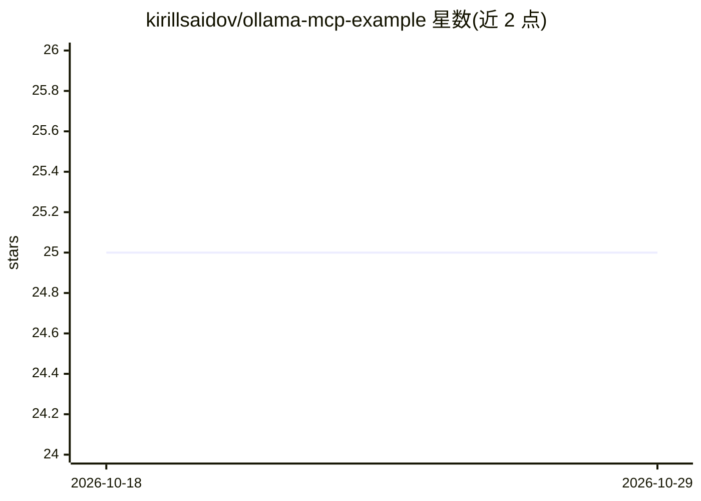

# kirillsaidov/ollama-mcp-example

⭐ 25 · Python · Unlicense · 推送 2026-07-10 · [GitHub](https://github.com/kirillsaidov/ollama-mcp-example) · 个人维护

**面向初学者的 Ollama MCP 服务器/客户端搭建示例**

从零演示 MCP 机制的可运行教学项目：用 mcp_server.py 通过网络暴露工具，mcp_client.py 连接 MCP server、拉取工具列表并转换为 Ollama 可用的函数调用格式，再由 LLM 决定是否调用工具。README 逐步讲解 MCP 三组件（server/client/LLM）关系与调用流程，示例工具为股价查询，并演示如何用 @mcp.tool() 装饰器添加自定义函数。运行需 Python 3.10+、本地已安装的 Ollama 及 qwen3:4b-instruct 模型。采用 Unlicense 许可。

## 筛选速览

| 维度 | 判定 | 备注 |
|---|---|---|
| AI 角色 | `ai-knowledge` | 知识聚合/清单类 |
| 许可风险 | `permissive` | Unlicense |
| 部署形态 | `library` | 以包/库形式分发 |
| 模型依赖 | local-ok | 支持本地模型 |
| 硬件要求 | — | 无带数字的原话,不猜 |
| 安装摩擦 | `low` | 无编译、无系统依赖或容器化 |
| 成熟度 | — | 结构信号不足 |

## 能力要点

- 同时包含 MCP server 与 MCP client 两端实现
- 客户端将 MCP 工具转换为 Ollama 函数调用格式并路由回服务器执行
- 示例演示用 @mcp.tool() 装饰器添加自定义工具
- README 图文讲解 MCP 三组件协作机制

## 适用场景

- 初学者理解并跑通 MCP server/client 与 Ollama 的完整链路
- 以此为模板给自己的 LLM 应用接入可复用工具
- 对比普通函数调用与 MCP 方式的差异

## 场景标签

`教程课程` · 领域:学习与行业

## 证据(README 行号)

> L2: This is a simple, beginner-friendly example showing how to set up and use an **MCP server and client from scratch wi
> L22: This project demonstrates how to set up and use MCP from scratch, showing what happens on both sides of the client 
> L25: 3. Handle chat and tool calls with Ollama.

## 星数曲线

2026-10-18 25 → 2026-10-29 25（+0）

---
*卡片 v1 · prompt 1.4 · 生成 2026-10-27 · 置信度 mid · 依据 README sha `e355e23f9b7a` · [字段定义](../../DATASET.md)*
