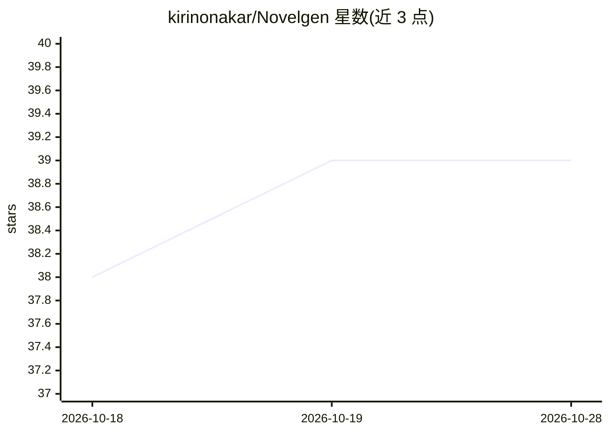

# kirinonakar/Novelgen

⭐ 39 · TypeScript · MIT · 推送 2026-10-28 · [GitHub](https://github.com/kirinonakar/Novelgen) · 个人维护

**面向读者的桌面端 AI 小说生成器：从创意自动产出完整小说**

Rust/Tauri 桌面应用，面向想读到自己设想小说但缺乏时间或写作能力的读者：输入种子创意，生成并可分章节精修大纲，再按大纲逐章生成完整小说。支持本地生成（LM Studio、Unsloth Desktop、Ollama）与云端生成（Google Gemini、OpenRouter、Cerebras 等），可产出韩语、日语或英语故事。提供批量生成、任务队列、断点续写、分层上下文记忆与章节级精修；API 密钥存于 Windows Credential Manager，Windows 需 Edge WebView2 运行时。

## 筛选速览

| 维度 | 判定 | 备注 |
|---|---|---|
| AI 角色 | `ai-native` | 本体是模型或模型工具 |
| 许可风险 | `permissive` | MIT |
| 部署形态 | `desktop` | 安装包/桌面程序 |
| 模型依赖 | local-ok | 支持本地模型 |
| 硬件要求 | — | 无带数字的原话,不猜 |
| 安装摩擦 | `low` | 无编译、无系统依赖或容器化 |
| 成熟度 | — | 结构信号不足 |

## 能力要点

- 种子→大纲→逐章成文的两阶段生成流程，支持手动编辑与自动批处理
- 接入 LM Studio、Unsloth Desktop、Ollama 本地运行及 Gemini、OpenRouter、Cerebras 等云端服务
- 13 章以上长篇分段生成大纲与聚焦上下文，支持断点续写
- 分层记忆、章节摘要与滑动窗口维持长篇一致性

## 适用场景

- 把自己的设定、角色和题材变成一本可读的完整小说
- 一次生成多个故事变体挑选最合口味的一版
- 对已完成草稿按章节范围做定向修改

## 场景标签

`AI 写作` · 领域:内容生成

## 证据(README 行号)

> L3: **NovelGen AI** is a personalized AI story generator for readers who have a story they want to experience but lack t
> L7: Enter a seed, generate or refine a plot, and let the app produce a full chapter-by-chapter story that matches the ki
> L15:  - Supports local generation through **LM Studio**, **Unsloth Desktop**, and **Ollama**, and cloud generation throu

## 星数曲线

2026-10-18 38 → 2026-10-28 39（+1）

---
*卡片 v1 · prompt 1.4 · 生成 2026-10-25 · 置信度 high · 依据 README sha `fc6a049ef7c2` · [字段定义](../../DATASET.md)*
