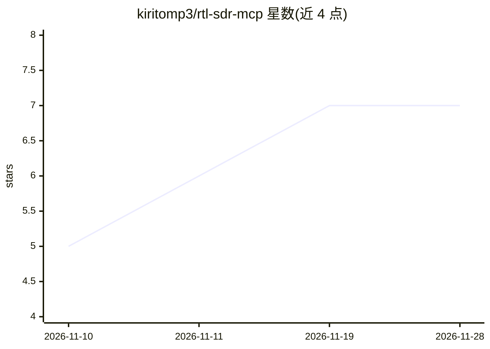

# kiritomp3/rtl-sdr-mcp

⭐ 7 · Python · MIT · 推送 2026-11-10 · [GitHub](https://github.com/kiritomp3/rtl-sdr-mcp) · 个人维护

**给 LLM agent 接入 RTL-SDR 收音机硬件的 MCP 服务器**

MCP 服务器，将 RTL2832U 电视棒封装为 AI agent 可自主调用的工具集：频谱扫描、瀑布图与频谱图图像输出、WFM/NFM/AM/USB/LSB 解调、whisper.cpp 语音转录、rtl_433 解码 200+ ISM 协议、间歇发射源监测与卫星过境查询。面向拥有 Claude Code/Claude Desktop 等 MCP 客户端与 SDR 硬件的用户。无线电为共享资源，工具调用用锁串行化；仅接收，转录功能需另行下载模型。

## 筛选速览

| 维度 | 判定 | 备注 |
|---|---|---|
| AI 角色 | `ai-ecosystem` | LLM/agent 周边工具 |
| 许可风险 | `permissive` | MIT |
| 部署形态 | `None` |  |
| 模型依赖 | — | README 未给出锁定关系 |
| 硬件要求 | — | 无带数字的原话,不猜 |
| 安装摩擦 | `low` | 无编译、无系统依赖或容器化 |
| 成熟度 | — | 结构信号不足 |

## 能力要点

- 7 个 MCP 工具：sweep/waterfall/listen/activity_monitor/decode_devices 等
- 瀑布图与频谱以图像返回，供多模态模型推理
- listen 工具经 whisper.cpp 将解调语音转录为文本
- rtl_433 解码 200+ ISM 协议（气象站、TPMS、门铃等）

## 适用场景

- 让 agent 扫描周边频段并解释最强信号
- 监测 433 MHz 附近的间歇发射源并识别设备
- 查找正在播讲话的 FM 电台并总结内容
- 查询 ISS/Meteor-M 卫星过境并在过境时收听

## 场景标签

`语音识别` · 领域:感知与多模态

## 证据(README 行号)

> L3: **Give your LLM agent a real radio.** An MCP server that turns a $30 RTL-SDR dongle into tools an AI agent can use o
> L9: rtl-sdr-mcp
> L109:     A[LLM agent] -- MCP tool call --> S[sdr-mcp]

## 星数曲线

2026-11-10 5 → 2026-11-28 7（+2）

---
*卡片 v1 · prompt 1.4 · 生成 2026-11-20 · 置信度 high · 依据 README sha `da1b2da1c395` · [字段定义](../../DATASET.md)*
