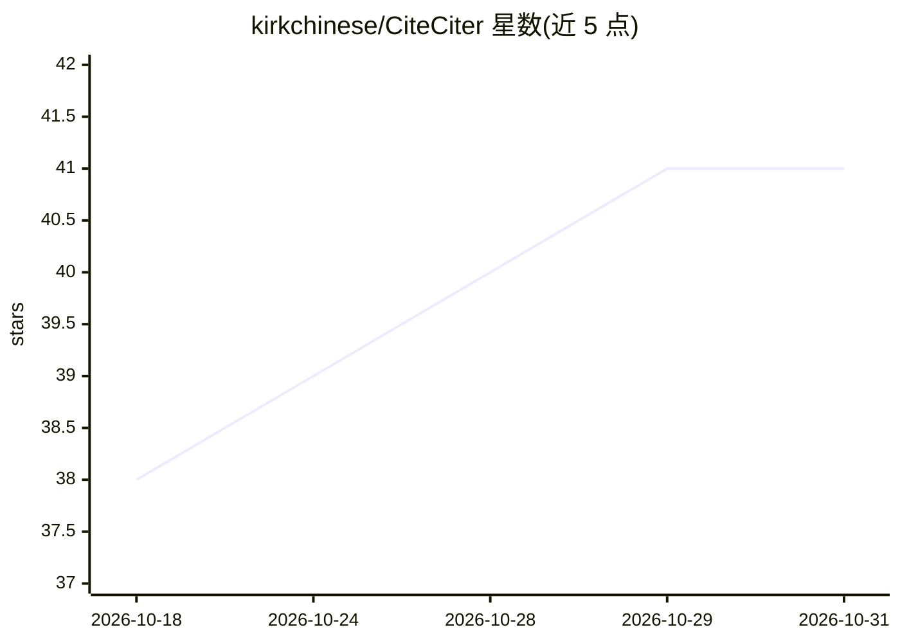

# kirkchinese/CiteCiter

⭐ 41 · JavaScript · MIT · 推送 2026-10-25 · [GitHub](https://github.com/kirkchinese/CiteCiter) · 个人维护 · 中文 README

**DeepSeek Harness 插件：选中 AI 回答内容追问与学习，不改主对话**

面向 DeepSeek Harness（DSH）用户的插件：在对话、工具结果或文档中选中一段内容，即可在带来源引用的独立 Topic 中向 AI 追问、讲解、翻译或找错误，主对话不被改动。支持 Markdown/公式/SVG/图片的小黑板、可导出的学习卡、文件附件阅读、引用胶囊回注主对话等；新 Topic 默认只读，复用 DSH 的模型、工具、审批与沙箱。通过 npm 包或 Git 仓库安装，插件版本须与 DSH 宿主版本精确匹配，主要在 Windows 上测试。

## 筛选速览

| 维度 | 判定 | 备注 |
|---|---|---|
| AI 角色 | `ai-native` | 本体是模型或模型工具 |
| 许可风险 | `permissive` | MIT |
| 部署形态 | `None` |  |
| 模型依赖 | locked-api |  |
| 硬件要求 | — | 无带数字的原话,不猜 |
| 安装摩擦 | `low` | 无编译、无系统依赖或容器化 |
| 成熟度 | `idea` | |

## 能力要点

- 选中内容即在独立 Topic 中追问，保留来源引用且不改动主对话
- 小黑板支持 Markdown/公式/SVG/图片/隔离 HTML，可编排动画
- 可导出、可修订的学习卡与草稿自动保存
- 新 Topic 默认只读，复用 DSH 的审批、沙箱与权限体系

## 适用场景

- 对 Agent 刚完成的任务追问'它是怎么做的'并检查理解
- 针对某段 AI 回答或代码做带来源的独立讨论与反驳
- 把 AI 工作过程整理成学习卡与小黑板留档回看

## 场景标签

`AI 助手` `知识库管理` · 领域:对话与助手

## 证据(README 行号)

> L9: CiteCiter 是 DeepSeek Harness（DSH） 的插件，帮助你从 Agent 的真实工作中学习。选中对话、工具结果或文档中的一段内容，在保留来源的独立 Topic 里追问，用小黑板理解关键关系，再回到原来的工作。
> L57: |理解一段回答、代码或工具结果|带来源引用的独立 Topic，追问不会写入主对话|

## 星数曲线

2026-10-18 38 → 2026-10-31 41（+3）

---
*卡片 v1 · prompt 1.4 · 生成 2026-10-25 · 置信度 mid · 依据 README sha `5c2d94336f67` · [字段定义](../../DATASET.md)*
