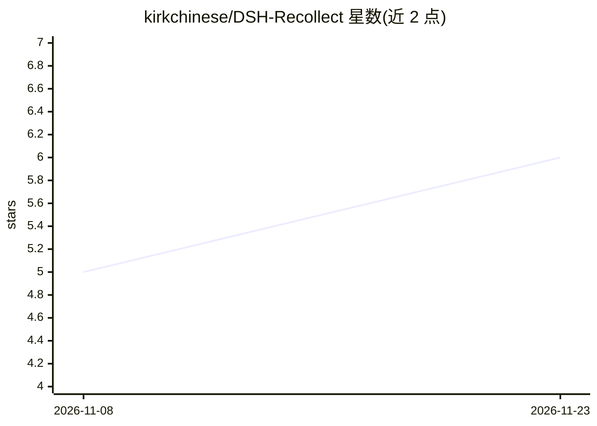

# kirkchinese/DSH-Recollect

⭐ 6 · JavaScript · MIT · 推送 2026-11-18 · [GitHub](https://github.com/kirkchinese/DSH-Recollect) · 个人维护 · 中文 README

**为 DSH 提供兼容 Claude Code 约定的持久记忆插件**

Recollect 是 DeepSeek Harness（DSH）的插件，提供一套兼容 Claude Code 文件约定的记忆系统：按目录分层加载 CLAUDE.md/AGENTS.md 指令文件（支持 @import、rules），以 MEMORY.md 为索引存放持久记忆，并为所有模型注入同一套完整记忆写作指导。提供记忆召回（本地 BM25，支持中英日韩）、后台提取、24 小时周期整理（dream）、与 Claude Code 记忆目录导入/共用、沙箱自适应写入及设置面板。通过 npm 包或 Git 地址在 DSH 插件页安装，支持 Linux 与 Windows（Windows 上后台提取与 dream 默认关闭）。

## 筛选速览

| 维度 | 判定 | 备注 |
|---|---|---|
| AI 角色 | `ai-ecosystem` | LLM/agent 周边工具 |
| 许可风险 | `permissive` | MIT |
| 部署形态 | `None` |  |
| 模型依赖 | — | README 未给出锁定关系 |
| 硬件要求 | — | 无带数字的原话,不猜 |
| 安装摩擦 | `low` | 无编译、无系统依赖或容器化 |
| 成熟度 | — | 结构信号不足 |

## 能力要点

- 兼容 Claude Code 的 CLAUDE.md/@import/.claude/rules 与 MEMORY.md 记忆格式
- 本地 BM25F 记忆召回，支持中英日韩
- 与 Claude Code 记忆目录互导或共用（/memory-import、shareProjects）
- 沙箱自适应：workspace-write 下挂载受限 memory_* 工具

## 适用场景

- 在 DSH 中换用不同模型时保留同一套记忆与指导
- 把已有的 Claude Code 记忆迁移或共用给 DSH
- 跨会话积累用户偏好、项目背景等长期记忆

## 场景标签

`Agent 记忆` · 领域:Agent 开发

## 证据(README 行号)

> L9: Recollect 是 DeepSeek Harness（DSH） 的插件：一套**兼容 Claude Code 的记忆系统**。它沿用 Claude Code 的约定：按目录分层的 `CLAUDE.md`、`@import`、`.
> L30: ## 安装
> L36: **官方桌面版：** 在插件页安装 npm 包 `@kirkchinese/dsh-recollect`，或在 Git 地址一栏填写 `https://github.com/kirkchinese/DSH-Recollect.gi

## 星数曲线

2026-11-08 5 → 2026-11-23 6（+1）

---
*卡片 v1 · prompt 1.4 · 生成 2026-11-21 · 置信度 high · 依据 README sha `879d3a33f7b1` · [字段定义](../../DATASET.md)*
