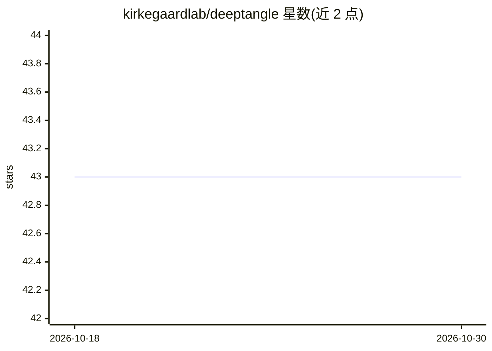

# kirkegaardlab/deeptangle

⭐ 43 · Python · MIT · 推送 2026-06-30 · [GitHub](https://github.com/kirkegaardlab/deeptangle) · [官网](https://www.nature.com/articles/s42003-023-05098-1) · 组织维护

**论文官方代码：高密度显微图像中细长体的快速检测**

Communications Biology 2023 论文 Fast detection of slender bodies in high density microscopy data 的官方实现，基于 JAX 的单阶段检测器，用样条/隐空间表示检测 C. elegans 等细长目标。提供训练脚本、检测与跟踪示例、论文权重下载链接与发表数据集（Zenodo）；附 CPU 版 Dockerfile。以源码仓库形式提供，需自建虚拟环境安装依赖。

## 筛选速览

| 维度 | 判定 | 备注 |
|---|---|---|
| AI 角色 | `ai-native` | 本体是模型或模型工具 |
| 许可风险 | `permissive` | MIT |
| 部署形态 | `self-host` | docker 或自建部署 |
| 模型依赖 | — | README 未给出锁定关系 |
| 硬件要求 | — | 无带数字的原话,不猜 |
| 安装摩擦 | `low` | 无编译、无系统依赖或容器化 |
| 成熟度 | — | 结构信号不足 |

## 能力要点

- 基于 JAX 的细长体单阶段检测实现
- 提供训练脚本（train.py）与检测/跟踪示例
- 论文权重与 Zenodo 数据集可直接下载
- 附 CPU 版 Dockerfile 与运行脚本

## 适用场景

- 在高密度显微图像中检测 C. elegans 等细长生物体
- 复现论文训练流程或使用论文权重做检测/跟踪
- 将模型与辅助函数安装为库用于自己的分析代码

## 场景标签

`目标检测` · 领域:感知与多模态

## 证据(README 行号)

> L6: This repository contains the implementation of Fast detection of slender bodies in high density microscopy data pape
> L38: python3 train.py --batch_size=32 --eval_interval=10 --nworms=100,200 --save

## 星数曲线

2026-10-18 43 → 2026-10-30 43（+0）

---
*卡片 v1 · prompt 1.4 · 生成 2026-10-25 · 置信度 high · 依据 README sha `658c3bc5b2cc` · [字段定义](../../DATASET.md)*
