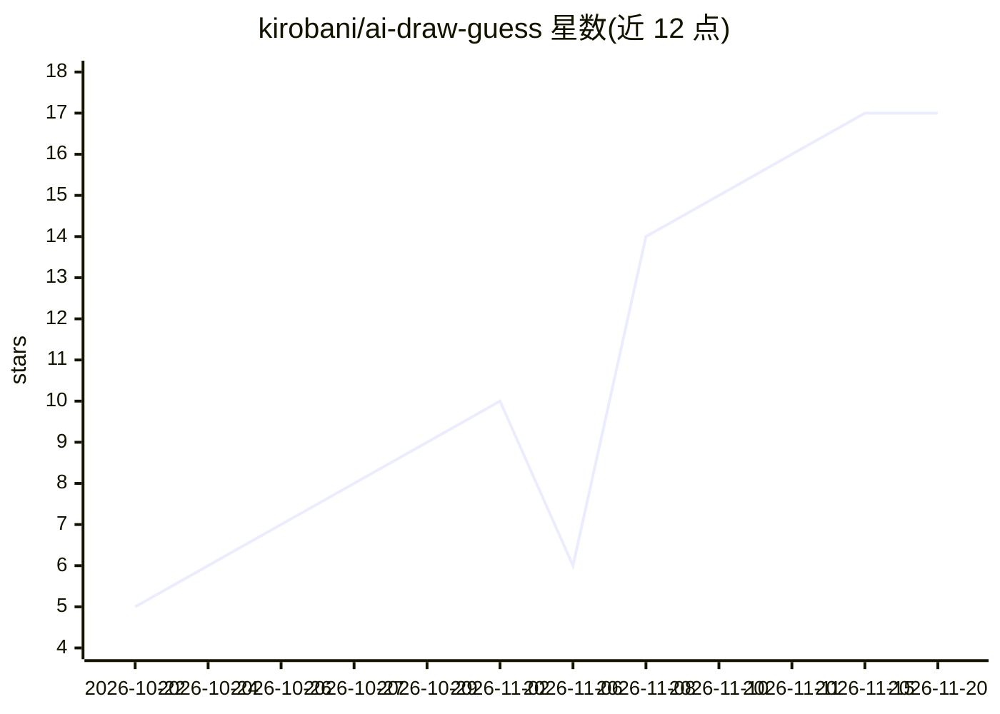

# kirobani/ai-draw-guess

⭐ 17 · JavaScript · MIT · 推送 2026-11-12 · [GitHub](https://github.com/kirobani/ai-draw-guess) · 个人维护 · 中文 README

**本地运行的你画我猜游戏：多个大模型角色互画互猜**

Node.js 本地网页游戏：玩家与多位 AI 选手玩你画我猜、画画接龙，AI 通过 OpenRouter 调用各厂商模型，识图用图片输入、画图由模型输出简笔画 JSON 由游戏绘制。提供 Live2D 角色资源安装（约 511 MiB，Cubism Core 需自行从官方 SDK 下载）、题库、赛后互怼与可重播的对局记录导出。默认仅监听回环地址，未实现多用户权限，API 调用由用户自己的账户计费。

## 筛选速览

| 维度 | 判定 | 备注 |
|---|---|---|
| AI 角色 | `ai-native` | 本体是模型或模型工具 |
| 许可风险 | `permissive` | MIT |
| 部署形态 | `None` |  |
| 模型依赖 | locked-api |  |
| 硬件要求 | — | 无带数字的原话,不猜 |
| 安装摩擦 | `low` | 无编译、无系统依赖或容器化 |
| 成熟度 | — | 结构信号不足 |

## 能力要点

- 每位 AI 选手独立配置接口地址、Key、型号与超时
- 画图机制为模型生成简笔画 JSON，无需原生图片生成接口
- 导出笔画、猜词、时间线与聊天，可在素材页重播重新构图
- npm run setup:avatars 安装 Live2D 角色资源，支持断点续传

## 适用场景

- 本地一个人和多个 AI 玩你画我猜或画画接龙
- 观察不同模型在同一场画画猜词对局中的表现
- 导出对局素材做复盘或二次创作

## 场景标签

`多模态` · 领域:感知与多模态

## 证据(README 行号)

> L3: 把 12 家 AI 请到同一张画桌：你画它们猜、它们画你猜，也可以一起玩画画接龙。角色有各自的性格、高清 Live2D 表情和赛后互怼。
> L64: 所有角色默认独立调用对应厂商的 OpenRouter 型号，**包括 GPT**，不是同一个模型换角色扮演。型号目录来自 OpenRouter Models API，可按厂商选择、手动输入 ID，并查看请求型号与平台返回的型号回执
> L83: **识图**需要图片输入；**画图**是模型生成简笔画 JSON，由游戏绘制，不需要额外的原生图片生成接口。模型的身份和 Live2D 角色可分别选择。GPT 可选本机 Codex CLI，但默认不依赖它，也不会读取其他项目的密钥

## 星数曲线

2026-10-22 5 → 2026-11-20 17（+12）

---
*卡片 v1 · prompt 1.4 · 生成 2026-11-18 · 置信度 high · 依据 README sha `109e7ec9ee6e` · [字段定义](../../DATASET.md)*
