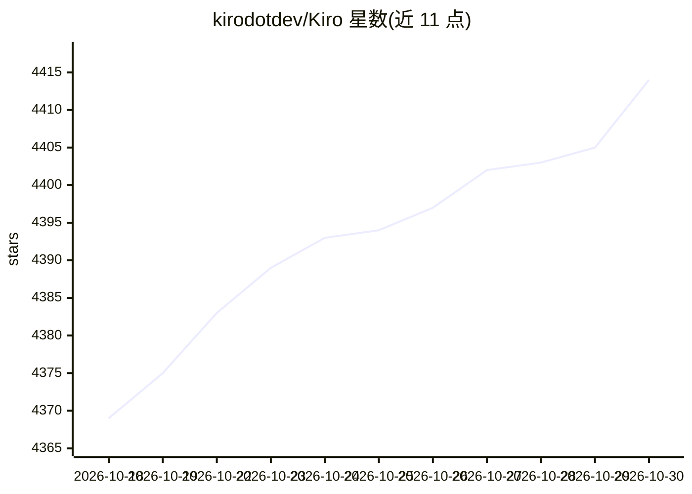

# kirodotdev/Kiro

⭐ 4,414 · TypeScript · 推送 2026-10-18 · [GitHub](https://github.com/kirodotdev/Kiro) · [官网](https://kiro.dev) · 组织维护

**Kiro 的公开 issue 与反馈跟踪仓库（产品本体不在此托管）**

Kiro 是面向开发者和团队的 agentic AI 开发平台，覆盖从原型到生产的规划、构建与审查；提供 IDE、CLI、Web、Mobile、Crew 五种使用入口，统一 agent harness 使 specs、steering、权限、hooks、MCP 与自定义 agent 跨入口跟随项目。功能包括 Specs 需求结构化、基于属性的 correctness 测试、云端沙箱会话（Preview）与企业管理。本仓库仅托管 issue 反馈与问题分诊自动化，产品源码不在此处；安全漏洞需经 AWS/Amazon Security 渠道报告。

## 筛选速览

| 维度 | 判定 | 备注 |
|---|---|---|
| AI 角色 | `ai-ecosystem` | LLM/agent 周边工具 |
| 许可风险 | `none` | — |
| 部署形态 | `None` |  |
| 模型依赖 | — | README 未给出锁定关系 |
| 硬件要求 | — | 无带数字的原话,不猜 |
| 安装摩擦 | `low` | 无编译、无系统依赖或容器化 |
| 成熟度 | — | 结构信号不足 |

## 能力要点

- IDE/CLI/Web/Mobile/Crew 五种入口共享同一 agent harness 与项目上下文
- Specs 需求分析与基于属性的 correctness 测试
- Hooks、Powers、MCP 扩展与 .kiroignore、检查点回滚等控制机制
- 企业接入路径：身份连接、组织级治理与用量监控

## 适用场景

- 用自然语言生成可执行 specs 并驱动多 agent 在大型代码库上并行开发
- 在终端或 CI/CD 中以无头方式运行开发代理
- 向 Kiro 报告 bug 或提出功能建议并参与社区讨论

## 场景标签

`编码 Agent` · 领域:编码与开发

## 证据(README 行号)

> L5:  Kiro is an agentic AI development platform that helps developers and teams plan, build, and review software. Turn p
> L13: This repository is the public issue and feedback tracker for Kiro. Use it to report bugs, suggest ideas, and discus

## 星数曲线

2026-10-18 4,369 → 2026-10-30 4,414（+45）

---
*卡片 v1 · prompt 1.4 · 生成 2026-10-20 · 置信度 high · 依据 README sha `cf1d99472bd6` · [字段定义](../../DATASET.md)*
