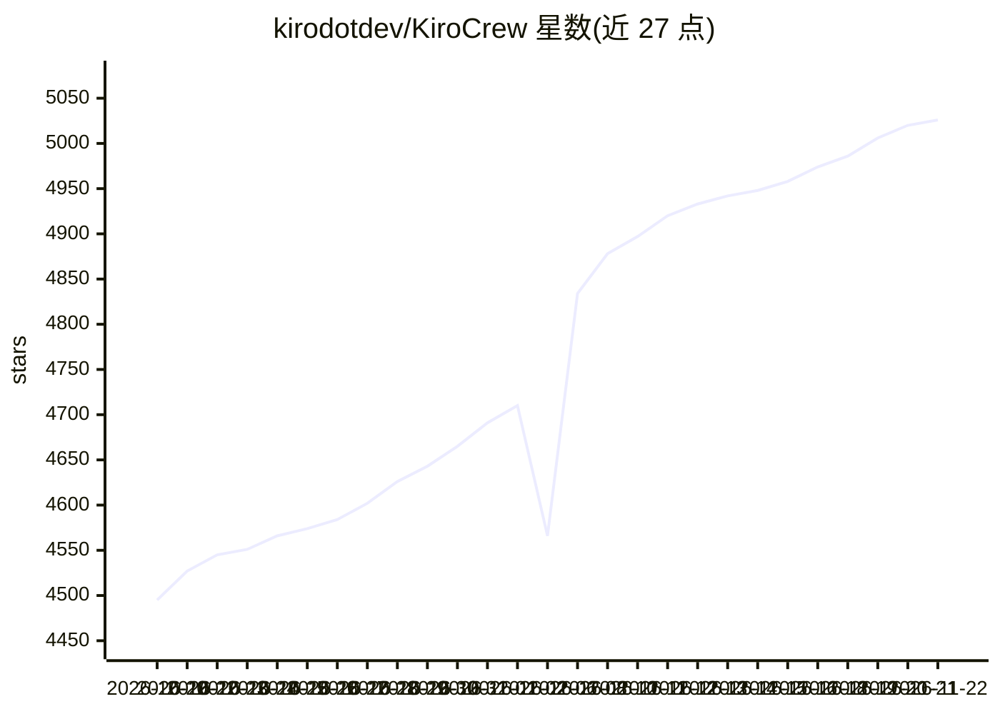

# kirodotdev/KiroCrew

⭐ 5,026 · Python · Apache-2.0 · 推送 2026-11-21 · [GitHub](https://github.com/kirodotdev/KiroCrew) · [官网](https://kiro.dev/crew/) · 组织维护

**持久化开发工作区：Agent 任务跨会话记忆、无人值守持续运行**

开源的开发工作区，可本地或远程运行在用户自有硬件上；核心是 Gateway 架构，将 Agent 会话运行与桌面应用、Web 仪表盘、CLI、Slack/Discord 等交互入口分离。会话、记忆、日程、任务检查点在 Gateway 重启后保留；纠正与任务失败转化为持久 lessons，重复模式合成为可编辑技能。支持长时任务规划执行与断点恢复、定时任务、子代理并行委派、MCP 工具扩展，并提供工具审批、OS 沙箱、敏感路径检查等安全控制。默认 Agent 依赖 kiro-cli 并需单独登录。

## 筛选速览

| 维度 | 判定 | 备注 |
|---|---|---|
| AI 角色 | `ai-ecosystem` | LLM/agent 周边工具 |
| 许可风险 | `permissive` | Apache-2.0 |
| 部署形态 | `desktop` | 安装包/桌面程序 |
| 模型依赖 | — | README 未给出锁定关系 |
| 硬件要求 | — | 无带数字的原话,不猜 |
| 安装摩擦 | `low` | 无编译、无系统依赖或容器化 |
| 成熟度 | — | 结构信号不足 |

## 能力要点

- 持久会话与记忆：重启后恢复，纠正/失败转化为持久 lessons
- 重复模式自动合成可复用、可编辑的技能
- 长时任务带检查点执行、验证与重试，支持定时与 webhook 触发的无人值守工作
- 桌面/Web/CLI/Slack/Discord 多入口共用同一 Gateway 状态

## 适用场景

- 让 Agent 无人值守地执行迁移计划等长时任务，失败自动重试
- 定时汇总待评审工作并推送到 Slack/Discord
- 让助手跨会话记住我的偏好与项目上下文
- 用子代理并行调研多个方案并汇总权衡

## 场景标签

`Agent 记忆` `多智能体` `工作流自动化` `编码 Agent` · 领域:Agent 开发

## 证据(README 行号)

> L9:  Kiro Crew is an open source development workspace that runs locally or remotely on
> L176:     G["Gateway access · sessions · memory · schedules · approvals · apps"]
> L39: always-on servers, or a build from source. The default agent runs on

## 星数曲线

2026-10-20 4,495 → 2026-11-22 5,026（+531）

---
*卡片 v1 · prompt 1.4 · 生成 2026-11-22 · 置信度 high · 依据 README sha `6497364e6b0f` · [字段定义](../../DATASET.md)*
