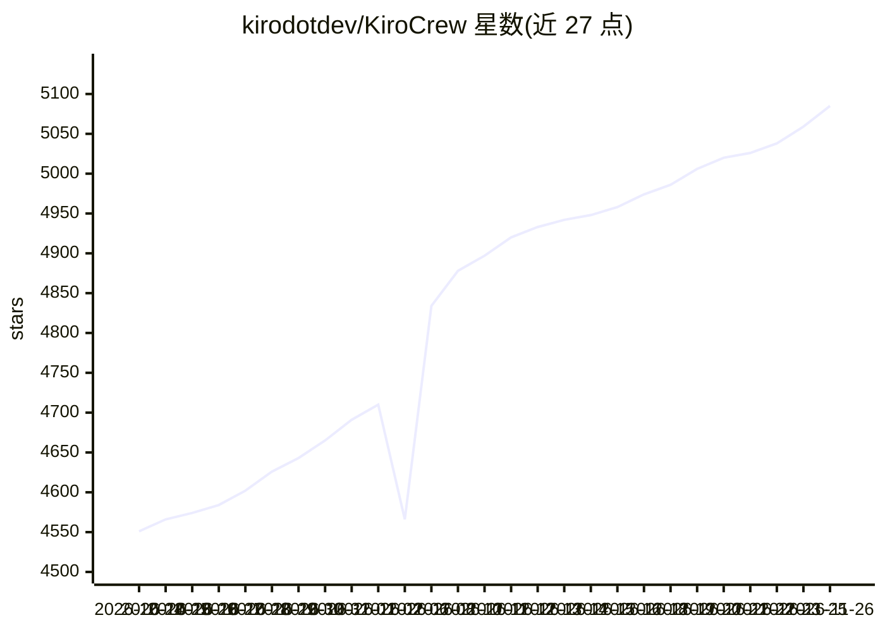

# kirodotdev/KiroCrew

⭐ 5,085 · Python · Apache-2.0 · 推送 2026-11-25 · [GitHub](https://github.com/kirodotdev/KiroCrew) · [官网](https://kiro.dev/crew/) · 组织维护

**跨会话持久运行、可自我改进的开发工作 Agent 工作区**

开源开发工作区，可本地或远程部署在自有硬件上，通过 Gateway 将会话、记忆、日程、审批等状态与工作界面分离：桌面应用、Web 仪表盘、CLI 及 Slack/Discord 均可接入同一工作流。支持多步任务无人值守执行（规划、校验、重试、断点恢复）、定时任务、子 Agent 并行委派、从纠错中沉淀持久化 lessons 与可复用 skills。默认 Agent 后端依赖单独安装并登录的 kiro-cli。提供桌面安装包、一键脚本、Docker 镜像与源码构建四种安装途径，Apache 2.0 许可。

## 筛选速览

| 维度 | 判定 | 备注 |
|---|---|---|
| AI 角色 | `ai-ecosystem` | LLM/agent 周边工具 |
| 许可风险 | `permissive` | Apache-2.0 |
| 部署形态 | `desktop` | 安装包/桌面程序 |
| 模型依赖 | — | README 未给出锁定关系 |
| 硬件要求 | — | 无带数字的原话,不猜 |
| 安装摩擦 | `low` | 无编译、无系统依赖或容器化 |
| 成熟度 | — | 结构信号不足 |

## 能力要点

- 会话、记忆、日程、断点跨 Gateway 重启持久化
- 纠错与失败沉淀为可编辑 lessons，重复模式合成为 skills
- 无人值守长任务：规划、校验、重试与断点恢复
- 工具审批、OS 沙箱、敏感路径检查等纵深安全控制

## 适用场景

- 把多步迁移/重构任务交给 Agent 无人值守跑完并按测试结果中断
- 定时在 Slack/Discord 收到工作摘要等周期性任务
- 让 Agent 从历史纠错中学习，在后续会话中保持团队偏好与项目上下文
- 并行派发子 Agent 研究多个方案并汇总权衡

## 场景标签

`工作流自动化` `编码 Agent` `Agent 框架` `多智能体` · 领域:Agent 开发

## 证据(README 行号)

> L9:  Kiro Crew is an open source development workspace that runs locally or remotely on
> L39: always-on servers, or a build from source. The default agent runs on
> L175:     S["Desktop app · Web dashboard · CLI · Messaging channels"]

## 星数曲线

2026-10-24 4,551 → 2026-11-26 5,085（+534）

---
*卡片 v1 · prompt 1.4 · 生成 2026-11-24 · 置信度 high · 依据 README sha `6ae023744c08` · [字段定义](../../DATASET.md)*
