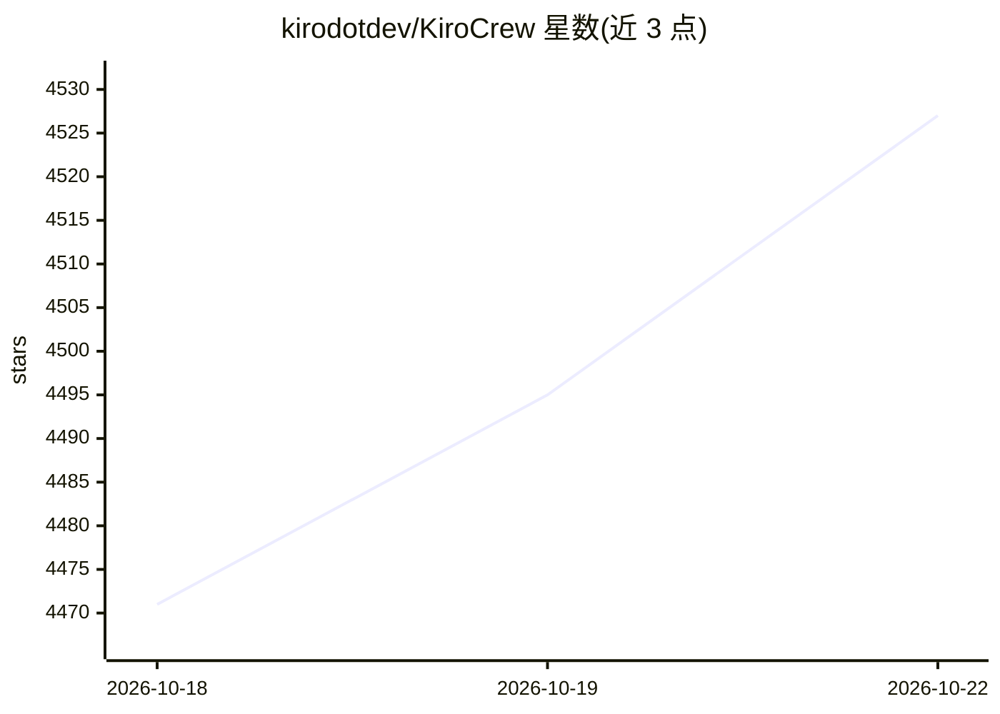

# kirodotdev/KiroCrew

⭐ 4,527 · Python · Apache-2.0 · 推送 2026-10-21 · [GitHub](https://github.com/kirodotdev/KiroCrew) · [官网](https://kiro.dev/crew/) · 组织维护

**面向开发者的持久化 AI agent 工作区：跨会话记忆、无人值守执行任务**

运行在用户自有硬件（本地或远程）上的开源开发工作区：通过 Gateway 管理持久会话、记忆、计划任务与审批，多步任务可无人值守执行并从检查点恢复；支持桌面应用、Web 面板、CLI 及 Slack/Discord 接入。自我学习机制将纠错与失败转为可复用经验，重复模式可沉淀为可编辑技能。默认 agent 运行于 kiro-cli（需单独安装登录），提供安装包、一行安装脚本、Docker 镜像与源码构建多种途径；含工具审批、沙箱与审计等安全控制，默认开启每日匿名遥测（可关闭）。

## 筛选速览

| 维度 | 判定 | 备注 |
|---|---|---|
| AI 角色 | `ai-native` | 本体是模型或模型工具 |
| 许可风险 | `permissive` | Apache-2.0 |
| 部署形态 | `desktop` | 安装包/桌面程序 |
| 模型依赖 | — | README 未给出锁定关系 |
| 硬件要求 | — | 无带数字的原话,不猜 |
| 安装摩擦 | `low` | 无编译、无系统依赖或容器化 |
| 成熟度 | — | 结构信号不足 |

## 能力要点

- 会话、记忆、计划任务与检查点在 Gateway 重启后持久保留
- 多步任务无人值守执行：规划、执行、验证、失败重试、断点恢复
- 自我学习与自我演化：纠错转为经验，重复模式生成可编辑技能
- 扩展机制：MCP 服务器、markdown 技能、hooks、可安装 Apps

## 适用场景

- 让 agent 按计划长期执行开发任务并在测试失败时停下
- 定时让 agent 汇总待处理工作并推送到 Slack/Discord
- 在自有硬件上维护跨会话记忆与项目上下文的开发助手

## 场景标签

`编码 Agent` `Agent 记忆` `AI 助手` · 领域:Agent 开发

## 证据(README 行号)

> L9:  Kiro Crew is an open source development workspace that runs locally or remotely on
> L154: |**Long-running tasks**|Give Kiro Crew a task spec and walk away. It plans steps, executes them, validates results

## 星数曲线

2026-10-18 4,471 → 2026-10-22 4,527（+56）

---
*卡片 v1 · prompt 1.4 · 生成 2026-10-20 · 置信度 high · 依据 README sha `c12c2807008a` · [字段定义](../../DATASET.md)*
