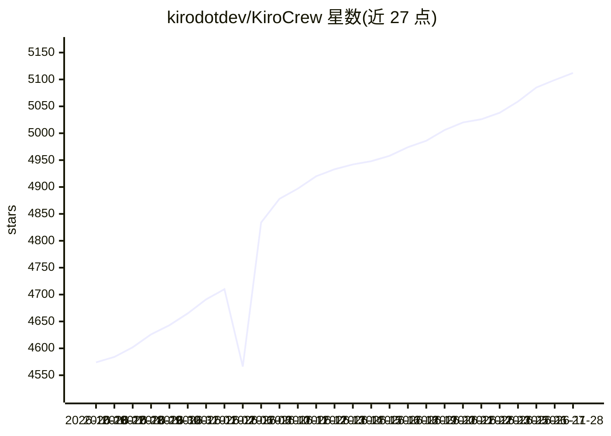

# kirodotdev/KiroCrew

⭐ 5,112 · Python · Apache-2.0 · 推送 2026-11-27 · [GitHub](https://github.com/kirodotdev/KiroCrew) · [官网](https://kiro.dev/crew/) · 组织维护

**面向开发者的跨会话持久化 AI agent 工作区**

一个可本地或远程运行的开源开发工作区，围绕 Gateway 组织：桌面应用、Web 仪表盘、CLI 与 Slack/Discord 等消息入口共享同一 agent 状态。核心机制包括跨重启保留的会话与记忆、将纠错转化为持久 lessons 的自学习、从重复模式合成可复用技能的自演化、带检查点与验证的长时任务、定时无人值守任务与并行子代理委派。安全方面提供工具审批、OS 沙箱、敏感路径检查与审计。默认 agent 依赖单独安装的 kiro-cli。

## 筛选速览

| 维度 | 判定 | 备注 |
|---|---|---|
| AI 角色 | `ai-ecosystem` | LLM/agent 周边工具 |
| 许可风险 | `permissive` | Apache-2.0 |
| 部署形态 | `desktop` | 安装包/桌面程序 |
| 模型依赖 | — | README 未给出锁定关系 |
| 硬件要求 | — | 无带数字的原话,不猜 |
| 安装摩擦 | `low` | 无编译、无系统依赖或容器化 |
| 成熟度 | — | 结构信号不足 |

## 能力要点

- 会话、记忆、调度与任务检查点跨 Gateway 重启保留
- 纠错与任务失败转为可编辑的持久 lessons 与可复用技能
- 定时任务与 webhook 触发的无人值守运行，无需人在终端
- 工具审批、OS 沙箱、敏感路径检查、凭据脱敏与审计事件

## 适用场景

- 把跨天、多步骤的开发任务交给 agent 无人值守执行
- 让助手记住项目偏好与历史纠错，延续到新会话
- 通过 Slack/Discord 或仪表盘在同一工作区继续任务
- 定时汇总待 review 的工作项并推送到指定渠道

## 场景标签

`编码 Agent` `Agent 记忆` `AI 助手` `多智能体` · 领域:Agent 开发

## 证据(README 行号)

> L9:  Kiro Crew is an open source development workspace that runs locally or remotely on
> L177:     A["Agent sessions ACP runtime · selected harness · MCP tools · models"]
> L181: The Gateway separates where the agent runs from where you work. Each

## 星数曲线

2026-10-26 4,574 → 2026-11-28 5,112（+538）

---
*卡片 v1 · prompt 1.4 · 生成 2026-11-27 · 置信度 high · 依据 README sha `4ed326c1337f` · [字段定义](../../DATASET.md)*
