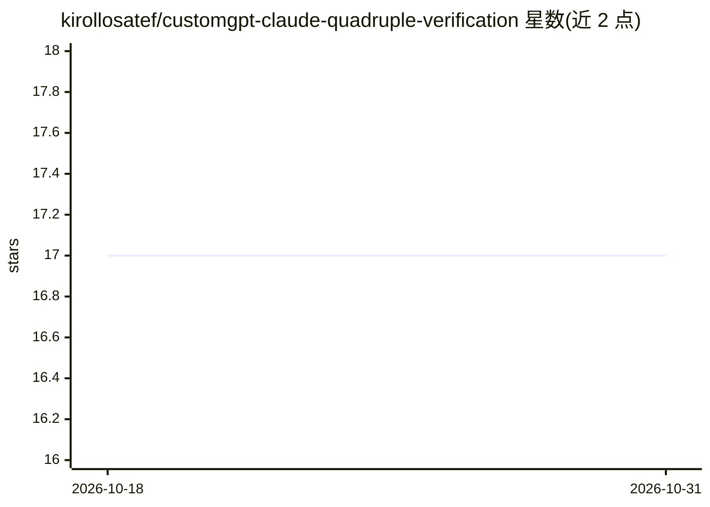

# kirollosatef/customgpt-claude-quadruple-verification

⭐ 17 · Python · MIT · 推送 2026-03-26 · [GitHub](https://github.com/kirollosatef/customgpt-claude-quadruple-verification) · [官网](https://kirollosatef.github.io/customgpt-claude-quadruple-verification) · 组织维护

**Claude Code 实时质量门禁插件：拦截不安全与虚构的 AI 生成代码**

基于 Claude Code hook 系统的验证插件，在代码写入文件前拦截操作：四个验证周期分别用正则快门拦截 TODO/占位符代码、eval()/硬编码密钥等安全问题，AI 自审层检查质量与完整性，另有针对研究文档的来源核查规则。每次操作输出 JSONL 审计日志。零依赖，需 Node.js >= 18 与 Claude Code CLI。提供 Marketplace 插件安装、npx 一键运行与手动脚本三种安装方式，Marketplace 安装每会话自动更新。

## 筛选速览

| 维度 | 判定 | 备注 |
|---|---|---|
| AI 角色 | `ai-ecosystem` | LLM/agent 周边工具 |
| 许可风险 | `permissive` | MIT |
| 部署形态 | `library` | 以包/库形式分发 |
| 模型依赖 | locked-api |  |
| 硬件要求 | — | 无带数字的原话,不猜 |
| 安装摩擦 | `low` | 无编译、无系统依赖或容器化 |
| 成熟度 | — | 结构信号不足 |

## 能力要点

- 4 个验证周期，28 条规则，正则门禁 <50ms
- 在代码生成时拦截，先于文件写入
- AI 自审 stop-gate 覆盖质量/安全/研究声明/完整性
- JSONL 审计日志 + 可选 LLM 咨询分析

## 适用场景

- 团队为 Claude Code 统一配置安全与质量门禁
- 在生成时拦截占位符代码和硬编码密钥
- 核查研究文档中的模糊表述与无来源声明

## 场景标签

`代码审查` · 领域:编码与开发

## 证据(README 行号)

> L21: Quadruple Verification intercepts Claude Code operations **in real time**, before code hits the filesystem. Regex f
> L110: The plugin uses Claude Code's hook system to intercept operations at three points:

## 星数曲线

2026-10-18 17 → 2026-10-31 17（+0）

---
*卡片 v1 · prompt 1.4 · 生成 2026-10-30 · 置信度 high · 依据 README sha `93bdc1e79bb8` · [字段定义](../../DATASET.md)*
