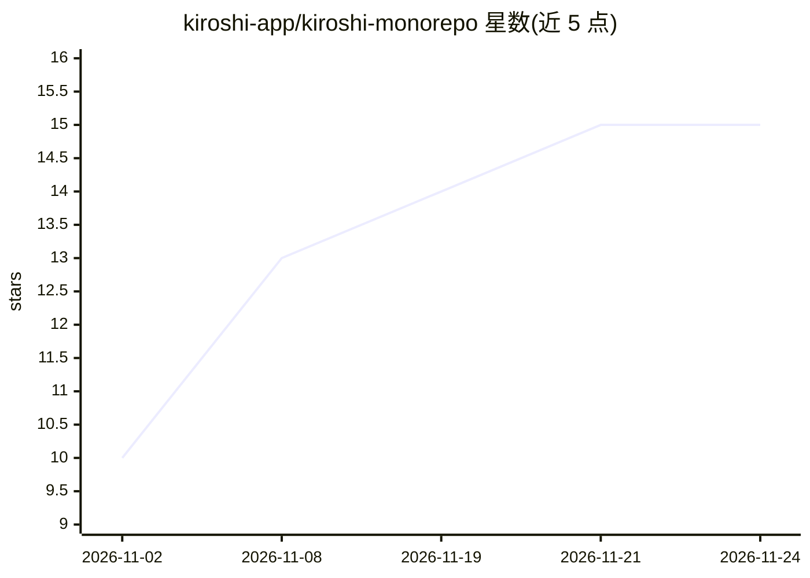

# kiroshi-app/kiroshi-monorepo

⭐ 15 · TypeScript · MIT · 推送 2026-11-19 · [GitHub](https://github.com/kiroshi-app/kiroshi-monorepo) · 个人维护

**给 Claude Code 用户的桌面多 Agent 编队应用**

基于 Tauri/React/Rust 的桌面应用，用户维护一组 Agent（各有名称、模型、工作目录与持久记忆），通过会话 @ 多个 Agent 协作、下派任务、设置定时/文件变更/webhook 触发的例行任务。桌面端免费本地运行；Pro 订阅提供中继共享 Space 与 iPhone 应用。模型走用户自己的 Claude 账户或 Anthropic API key，应用自带 coding session 可执行文件，无需另行安装。从源码构建需 Bun、Rust 工具链。

## 筛选速览

| 维度 | 判定 | 备注 |
|---|---|---|
| AI 角色 | `ai-native` | 本体是模型或模型工具 |
| 许可风险 | `permissive` | MIT |
| 部署形态 | `None` |  |
| 模型依赖 | locked-api |  |
| 硬件要求 | — | 无带数字的原话,不猜 |
| 安装摩擦 | `low` | 无编译、无系统依赖或容器化 |
| 成熟度 | `idea` | |

## 能力要点

- 每个 Agent 独立的模型、工作目录与持久记忆
- 会话中 @ 多个 Agent 同波协作，支持文件/图表/代码富渲染
- 任务系统跟踪 opened/ready to merge/checks failed 等状态并联动 GitHub 分支
- cron、文件变更、webhook 三类触发器驱动的例行任务

## 适用场景

- 同时管理多个编码 Agent 并行处理不同仓库的任务
- 让 Agent 定时或监听文件变化自动执行例行指令
- 通过共享 Space 与团队成员协作、iPhone 远程跟进

## 场景标签

`多智能体` `编码 Agent` `工作流自动化` · 领域:Agent 开发

## 证据(README 行号)

> L3: Kiroshi is a desktop app where you keep a team of agents. Each Agent has a name, a face, a job, a folder to work in 
> L66: The provider Kiroshi ships today is Claude. When you first open Kiroshi, sign-in offers two ways in:
> L64: Your Agents need a model to think with, on your own account with the model provider. Kiroshi ships the coding sessi

## 星数曲线

2026-11-02 10 → 2026-11-24 15（+5）

---
*卡片 v1 · prompt 1.4 · 生成 2026-11-18 · 置信度 high · 依据 README sha `a452d49f5bc7` · [字段定义](../../DATASET.md)*
