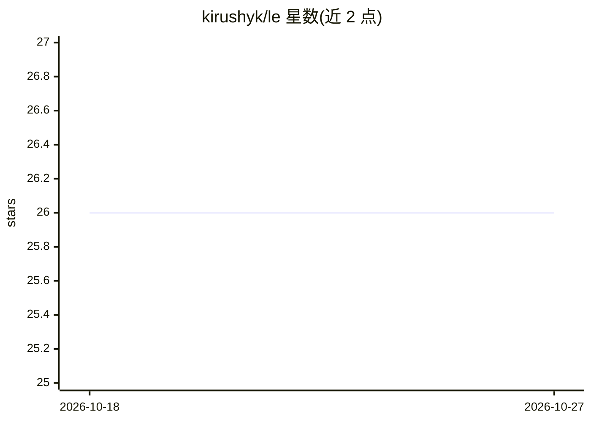

# kirushyk/le

⭐ 26 · C · MIT · 推送 2026-05-17 · [GitHub](https://github.com/kirushyk/le) · 个人维护

**纯 C 编写的底层机器学习库，提供回归、SVM、MLP、k-NN 等模型**

名为 Le 的底层机器学习库，以纯 C 编写并基于 GObject 采用面向对象结构，支持 C++ 与 Python 绑定（Rust 计划中）。已实现多项式回归、SVM、前馈神经网络（MLP）与 k-NN 四类模型，优化算法含 BGD、带动量的 SGD 与 SMO；后端支持 NVIDIA CUDA 与 Apple MPS。作者最初为学习 Andrew Ng 深度学习课程而创建，现用于复现论文或开源模型，项目处于活跃开发中。安装方式为从源码构建，附 C/C++/Python 示例与 Le Playground、Le MNIST Inspect 工具。

## 筛选速览

| 维度 | 判定 | 备注 |
|---|---|---|
| AI 角色 | `ai-native` | 本体是模型或模型工具 |
| 许可风险 | `permissive` | MIT |
| 部署形态 | `None` |  |
| 模型依赖 | — | README 未给出锁定关系 |
| 硬件要求 | — | 无带数字的原话,不猜 |
| 安装摩擦 | `medium` | 含编译或系统依赖之一 |
| 成熟度 | `idea` | |

## 能力要点

- 纯 C 实现并经 GObject 提供面向对象结构，附 C++/Python 绑定
- 已实现多项式回归、SVM、MLP、k-NN 四类模型
- 优化算法支持 BGD、带动量 SGD、SMO
- 后端支持 NVIDIA CUDA 与 Apple Metal Performance Shaders

## 适用场景

- 我在 C/C++/Python 项目中需要嵌入轻量的经典机器学习模型
- 我想在底层复现研究论文中的模型实现
- 我想在学习机器学习时阅读可读性高的 C 实现

## 场景标签

 · 领域:机器学习/库

## 证据(README 行号)

> L7: **Le** is a low-level machine learning library designed for readability and ease of use. Written in pure C, it, howe
> L15: At this moment following ML models are implemented:

## 星数曲线

2026-10-18 26 → 2026-10-27 26（+0）

---
*卡片 v1 · prompt 1.4 · 生成 2026-10-26 · 置信度 high · 依据 README sha `2c4fa812e0ed` · [字段定义](../../DATASET.md)*
