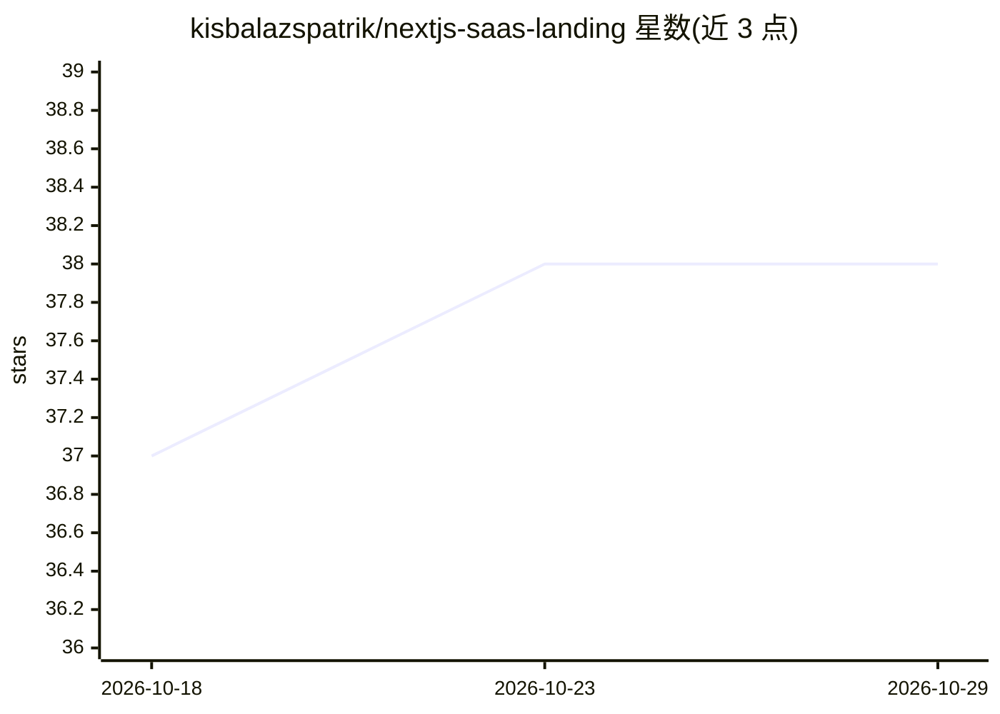

# kisbalazspatrik/nextjs-saas-landing

⭐ 38 · TypeScript · 推送 2026-03-30 · [GitHub](https://github.com/kisbalazspatrik/nextjs-saas-landing) · [官网](https://stargate.nfteam.eu) · 个人维护

**NextJS 构建的 SaaS 落地页模板，供软件产品展示**

基于 NextJS 的 SaaS 落地页模板，面向科技与初创领域需要展示软件产品的团队或个人。获取方式为 git clone 仓库后 npm install 安装依赖，npm run dev 启动开发服务器。功能包含落地页布局、响应式设计、服务端渲染页面，并集成 Chakra UI 组件库提供可定制的界面组件。采用 MIT 许可证。README 未包含 AI 相关功能或机制的描述。

## 筛选速览

| 维度 | 判定 | 备注 |
|---|---|---|
| AI 角色 | `ai-enhanced` | 去掉 AI 部分产品仍成立 |
| 许可风险 | `none` | — |
| 部署形态 | `library` | 以包/库形式分发 |
| 模型依赖 | — | README 未给出锁定关系 |
| 硬件要求 | — | 无带数字的原话,不猜 |
| 安装摩擦 | `low` | 无编译、无系统依赖或容器化 |
| 成熟度 | — | 结构信号不足 |

## 能力要点

- 基于 NextJS 的服务端渲染落地页
- 集成 Chakra UI 提供可定制组件
- 响应式设计，适配多种设备

## 适用场景

- 为自己的 SaaS 产品快速搭建落地页
- 初创产品上线前搭建展示页面
- 作为 NextJS + Chakra UI 项目起点进行二次开发

## 场景标签

 · 领域:Web 前端/模板

## 证据(README 行号)

> L5: # Stargate: NextJS SaaS Project Template
> L7: Stargate is a modern SaaS Landing Page template built with NextJS. It's designed to provide a seamless and engaging 

## 星数曲线

2026-10-18 37 → 2026-10-29 38（+1）

---
*卡片 v1 · prompt 1.4 · 生成 2026-10-25 · 置信度 high · 依据 README sha `534547e78861` · [字段定义](../../DATASET.md)*
