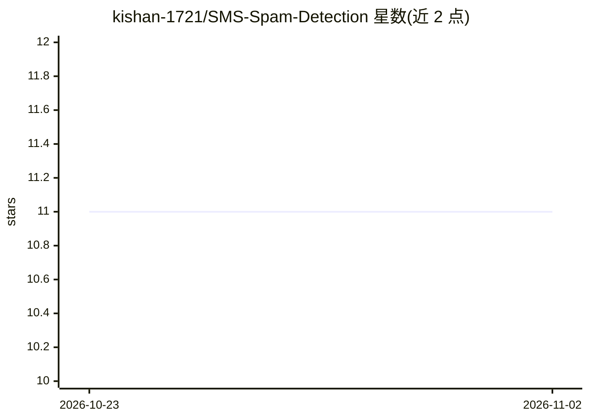

# kishan-1721/SMS-Spam-Detection

⭐ 11 · Jupyter Notebook · 推送 2026-10-22 · [GitHub](https://github.com/kishan-1721/SMS-Spam-Detection) · 个人维护

**SMS 垃圾短信分类项目：TF-IDF+监督学习判别 spam/ham**

基于 Python 的短信垃圾检测项目，使用 UCI SMS Spam Collection 数据集（5,574 条标注消息），通过 NLTK 预处理、TF-IDF 特征提取与监督学习算法训练分类器，将短信判为 spam 或 ham，并在留出集上输出 accuracy/precision/recall/F1 指标。提供 Streamlit 在线演示与本地脚本两种使用方式；依赖 pandas、numpy、scikit-learn、nltk、matplotlib，通过 pip 安装。

## 筛选速览

| 维度 | 判定 | 备注 |
|---|---|---|
| AI 角色 | `ai-native` | 本体是模型或模型工具 |
| 许可风险 | `none` | — |
| 部署形态 | `library` | 以包/库形式分发 |
| 模型依赖 | — | README 未给出锁定关系 |
| 硬件要求 | — | 无带数字的原话,不猜 |
| 安装摩擦 | `low` | 无编译、无系统依赖或容器化 |
| 成熟度 | — | 结构信号不足 |

## 能力要点

- TF-IDF 特征 + 监督学习分类 spam/ham
- 使用 UCI SMS Spam Collection 数据集（5,574 条）
- 输出 accuracy/precision/recall/F1 评估指标并提供 predict 函数
- 提供 Streamlit 在线演示

## 适用场景

- 判定收到的短信是否为垃圾短信
- 学习 NLP 文本分类的入门实践项目
- 基于标注数据训练并评估自己的垃圾短信分类器

## 场景标签

`网络安全` · 领域:学习与行业

## 证据(README 行号)

> L6: This project aims to develop a machine-learning model to detect spam messages in SMS text data. It utilizes natural 
> L38: 3. Run the `sms_spam_detection.py` script to train and evaluate the spam detection model.

## 星数曲线

2026-10-23 11 → 2026-11-02 11（+0）

---
*卡片 v1 · prompt 1.4 · 生成 2026-11-02 · 置信度 mid · 依据 README sha `412c41641516` · [字段定义](../../DATASET.md)*
