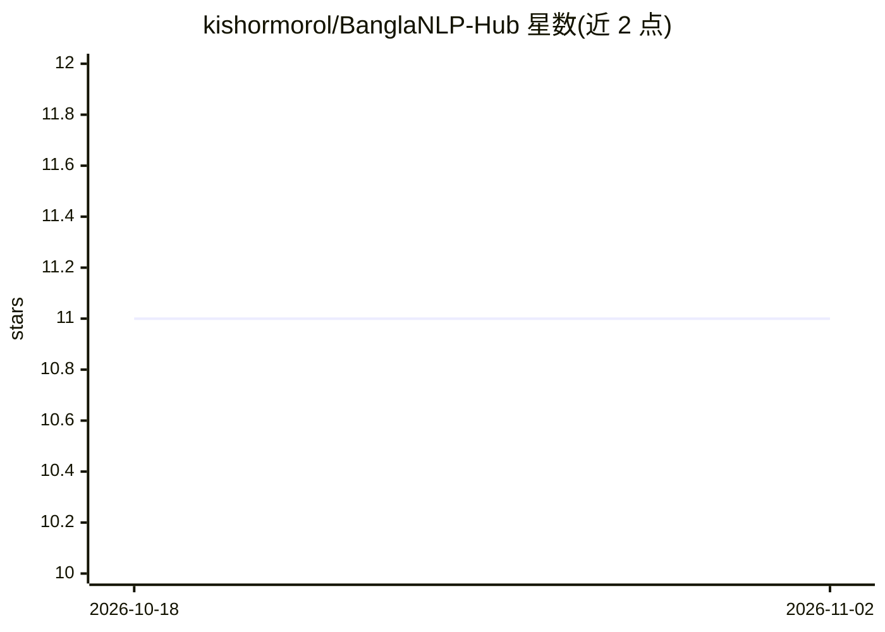

# kishormorol/BanglaNLP-Hub

⭐ 11 · Astro · MIT · 推送 2026-10-24 · [GitHub](https://github.com/kishormorol/BanglaNLP-Hub) · [官网](https://kishormorol.github.io/BanglaNLP-Hub/) · 个人维护

**孟加拉语 NLP 资源目录站：论文/数据集/模型/工具/基准**

社区维护的 Bangla（孟加拉语）NLP 资源编目：以 YAML 数据驱动的 Astro 静态站点，收录 814 篇论文、67 个数据集、22 个模型、9 个工具，按 26 个任务组织，支持可分享的 URL 过滤视图。强调数据诚实：不合成分数/BibTeX、榜单仅有引用来源的行、链接每夜核验、条目人工核对。提供 npm 脚本做校验、构建与链接检查，CI 门禁部署。面向低资源/Indic NLP 研究者与贡献者。

## 筛选速览

| 维度 | 判定 | 备注 |
|---|---|---|
| AI 角色 | `ai-knowledge` | 知识聚合/清单类 |
| 许可风险 | `permissive` | MIT |
| 部署形态 | `library` | 以包/库形式分发 |
| 模型依赖 | — | README 未给出锁定关系 |
| 硬件要求 | — | 无带数字的原话,不猜 |
| 安装摩擦 | `low` | 无编译、无系统依赖或容器化 |
| 成熟度 | — | 结构信号不足 |

## 能力要点

- 814 篇论文、67 个数据集、22 个模型、9 个工具，覆盖 26 个任务
- Zod schema 校验 + 每夜链接核验 + CI 门禁部署
- 严格'无来源不加值'策略：不合成分数、引用与 BibTeX
- URL 可分享的过滤视图（q/task/license/year 等）

## 适用场景

- 查找孟加拉语 NLP 数据集、模型与论文
- 按任务浏览低资源语言研究资源
- 为目录贡献经过人工核对的条目与榜单数据

## 场景标签

`精选清单` `科研工具` · 领域:学习与行业

## 证据(README 行号)

> L3: A community-maintained catalog of Bangla (Bengali) NLP resources — papers, datasets, models, tools, and benchmarks.
> L30: The catalog currently holds **814 papers**, **67 datasets**, **22 models**, and **9 tools** across **26 tasks** — t

## 星数曲线

2026-10-18 11 → 2026-11-02 11（+0）

---
*卡片 v1 · prompt 1.4 · 生成 2026-11-02 · 置信度 high · 依据 README sha `25ae43ba300e` · [字段定义](../../DATASET.md)*
