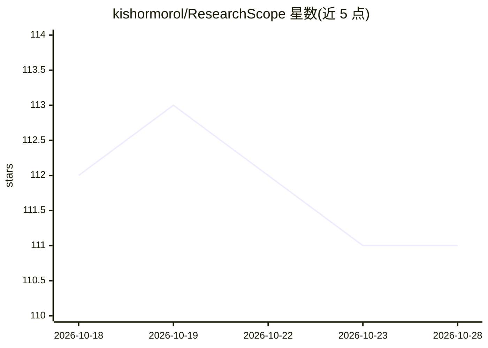

# kishormorol/ResearchScope

⭐ 111 · Python · MIT · 推送 2026-10-28 · [GitHub](https://github.com/kishormorol/ResearchScope) · [官网](https://kishormorol.github.io/ResearchScope/) · 个人维护

**CS/AI 论文研究情报平台：25万+论文评分排序与研究缺口发现**

面向计算机科学与 AI 领域的开放研究情报平台：每日 GitHub Actions 流水线从 arXiv、OpenAlex、ACL Anthology、OpenReview、PMLR、CVF、Semantic Scholar 等 7 个数据源抓取论文，按新近度、会议等级、接收档位、新颖性、作者声望与引用质量多信号打分，并检测研究缺口、推荐投稿 venue、追踪会议截止日期。数据同步至 Railway PostgreSQL（支撑 FastAPI REST API 与全文检索）及 HuggingFace Hub（JSONL 数据集）。另提供 pip 安装的 CLI 原型，支持本地检索、保存与缺口分析；Web 端含 JWT 账户、收藏同步与基于 OpenAI 的论文 PDF 对话（带页级引用）。

## 筛选速览

| 维度 | 判定 | 备注 |
|---|---|---|
| AI 角色 | `ai-knowledge` | 知识聚合/清单类 |
| 许可风险 | `permissive` | MIT |
| 部署形态 | `library` | 以包/库形式分发 |
| 模型依赖 | — | README 未给出锁定关系 |
| 硬件要求 | — | 无带数字的原话,不猜 |
| 安装摩擦 | `low` | 无编译、无系统依赖或容器化 |
| 成熟度 | `idea` | |

## 能力要点

- 每日流水线聚合 7 个数据源的 100K+ 论文并多信号打分
- 会议+期刊投稿推荐器与 A*/A 会议截止日期追踪
- 三层研究缺口抽取（显式/模式检测/起步想法）
- HuggingFace 发布 papers.jsonl 与 instruct.jsonl LLM 训练数据集

## 适用场景

- 查找并排序某方向的计算机科学论文
- 发现某个研究方向尚未被充分覆盖的缺口主题
- 根据摘要获得投稿会议与期刊推荐
- 获取可用于预训练或 RAG 的论文数据集

## 场景标签

`科研工具` `文档问答` · 领域:知识与检索

## 证据(README 行号)

> L20: ResearchScope is an **open research intelligence platform** for computer science and AI. A daily GitHub Actions pip
> L88: |🤗 **LLM training data**|`papers.jsonl` + `instruct.jsonl` on HuggingFace Hub|

## 星数曲线

2026-10-18 112 → 2026-10-28 111（-1）

---
*卡片 v1 · prompt 1.4 · 生成 2026-10-23 · 置信度 high · 依据 README sha `93a48428e744` · [字段定义](../../DATASET.md)*
