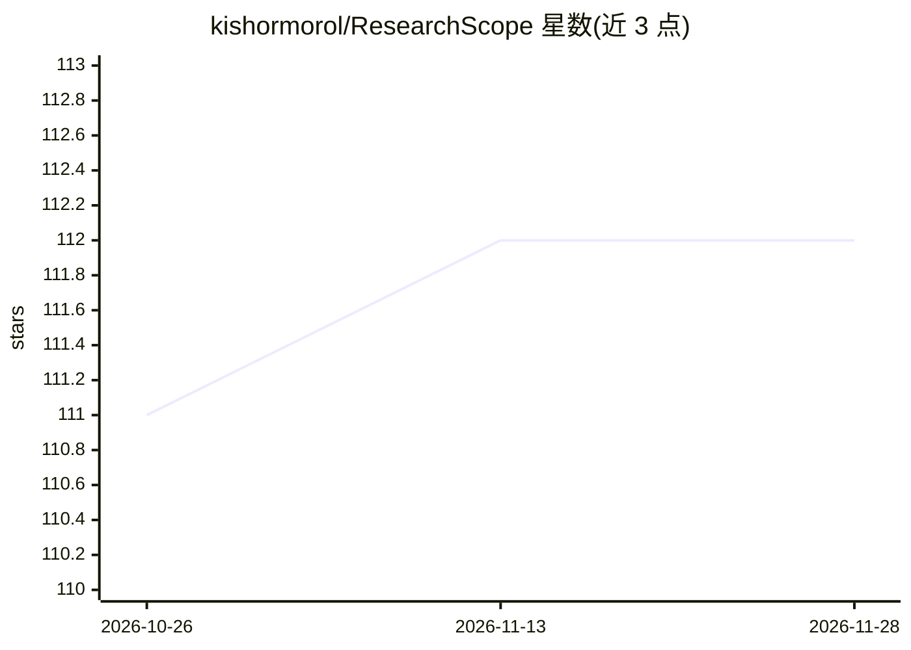

# kishormorol/ResearchScope

⭐ 112 · Python · MIT · 推送 2026-11-27 · [GitHub](https://github.com/kishormorol/ResearchScope) · [官网](https://kishormorol.github.io/ResearchScope/) · 个人维护

**面向 CS 研究者的论文评分检索与研究缺口发现平台**

ResearchScope 通过每日 GitHub Actions 流水线从 arXiv、OpenAlex、ACL Anthology 等 6 类数据源抓取论文，按时效、会议层级、新颖性、作者声望、引用质量等多信号评分排序，并检测研究缺口、推荐投稿 venue。数据同步到 Railway PostgreSQL（支撑 FastAPI REST API 与全文检索）和 Hugging Face 公开 JSONL 数据集。附 Python CLI 支持本地检索、保存与分析；网页端含会议截止日期倒计时、PDF 划屏问答（默认关闭，需服务端配置 API key）与 JWT 账户系统。

## 筛选速览

| 维度 | 判定 | 备注 |
|---|---|---|
| AI 角色 | `ai-enhanced` | 去掉 AI 部分产品仍成立 |
| 许可风险 | `permissive` | MIT |
| 部署形态 | `library` | 以包/库形式分发 |
| 模型依赖 | — | README 未给出锁定关系 |
| 硬件要求 | — | 无带数字的原话,不猜 |
| 安装摩擦 | `low` | 无编译、无系统依赖或容器化 |
| 成熟度 | — | 结构信号不足 |

## 能力要点

- 10 万+论文的多信号评分与排名
- A*/A 会议与 20 种 Q1 期刊覆盖，含截止日期倒计时
- 3 层研究缺口提取与会议/期刊推荐器
- Hugging Face 公开 JSONL 数据集供 LLM 训练

## 适用场景

- 每天快速找到值得读的 CS/AI 论文
- 投稿前获取会议与期刊匹配推荐并追踪截止日期
- 从已保存论文中发现研究空白选题
- 下载论文数据集用于 LLM 预训练或 RAG

## 场景标签

`科研工具` `文档问答` · 领域:知识与检索

## 证据(README 行号)

> L20: ResearchScope is an **open research intelligence platform** for computer science and AI. A daily GitHub Actions pip
> L85: |💬 **Chat with Paper**|Authenticated split-screen PDF chat with page citations and cross-device history (provider-c
> L211: |`CHAT_ENABLED`|Railway Env|Feature flag; defaults to `false`|

## 星数曲线

2026-10-26 111 → 2026-11-28 112（+1）

---
*卡片 v1 · prompt 1.4 · 生成 2026-11-28 · 置信度 mid · 依据 README sha `6d707ee168a1` · [字段定义](../../DATASET.md)*
