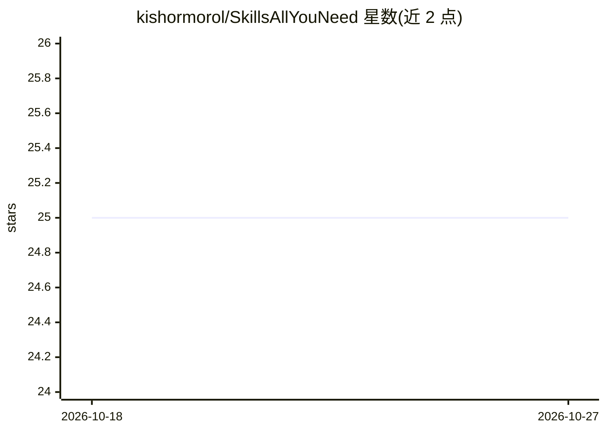

# kishormorol/SkillsAllYouNeed

⭐ 25 · CSS · CC-BY-4.0 · 推送 2026-09-18 · [GitHub](https://github.com/kishormorol/SkillsAllYouNeed) · [官网](https://kishormorol.github.io/SkillsAllYouNeed/) · 个人维护

**13 个 AI 助手生态的官方技能/能力目录站（226 条）**

覆盖 Claude、ChatGPT、Gemini、Cursor、Copilot 等 13 个 AI 助手生态的 226 个第一方技能条目，按 9 类组织，每条含触发短语、使用示例与官方来源链接。提供全文搜索、筛选、深链、收藏导出，以及 CC BY 4.0 的静态 skills.json API，可用于 RAG 语料或微调数据集。技术栈为模块化 HTML/CSS/JS，零构建、零运行时依赖，托管于 GitHub Pages。

## 筛选速览

| 维度 | 判定 | 备注 |
|---|---|---|
| AI 角色 | `ai-knowledge` | 知识聚合/清单类 |
| 许可风险 | `viral` | CC-BY-4.0 |
| 部署形态 | `None` |  |
| 模型依赖 | — | README 未给出锁定关系 |
| 硬件要求 | — | 无带数字的原话,不猜 |
| 安装摩擦 | `low` | 无编译、无系统依赖或容器化 |
| 成熟度 | — | 结构信号不足 |

## 能力要点

- 226 个技能条目覆盖 13 个生态、9 个类别
- 每条含触发短语、示例与官方来源链接
- skills.json 静态 API（CC BY 4.0），可用于 RAG/微调数据集
- 零构建零依赖的模块化 HTML/CSS/JS，GitHub Pages 托管

## 适用场景

- 查找某个 AI 助手的隐藏能力与触发方式
- 对比 13 个生态的 36 项能力矩阵
- 下载 skills.json 作为 RAG 管线或微调的数据集

## 场景标签

`精选清单` · 领域:学习与行业

## 证据(README 行号)

> L3: > The open registry of AI skills — ready-to-use capability definitions for Claude, Claude Code, ChatGPT, Codex, Open
> L18: **SkillsAllYouNeed** is a searchable, filterable reference directory of every first-party skill, capability, tool, 
> L74: - **skills.json API** — machine-readable corpus of all 226 skills (CC BY 4.0)

## 星数曲线

2026-10-18 25 → 2026-10-27 25（+0）

---
*卡片 v1 · prompt 1.4 · 生成 2026-10-27 · 置信度 high · 依据 README sha `c95fef8b7b90` · [字段定义](../../DATASET.md)*
