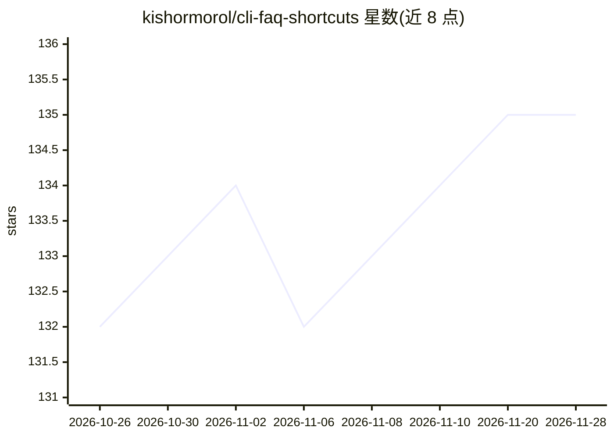

# kishormorol/cli-faq-shortcuts

⭐ 135 · Python · Apache-2.0 · 推送 2026-10-29 · [GitHub](https://github.com/kishormorol/cli-faq-shortcuts) · 个人维护

**把重复的编码 agent 提示词提炼成可复用斜杠命令的 Agent Skill**

一个 Claude Code / Codex / Cursor 通用的 Agent Skill：本地 Python 提取脚本（仅标准库，无依赖、无网络调用、无 API key）读取三个工具的历史记录，按项目文件夹匹配并输出用户输入的提示词；意图聚类由编码 agent 完成，统计重复次数后由用户挑选，为每条生成 SKILL.md 格式的快捷命令并写入项目。默认将粘贴的密钥等敏感内容替换为 [REDACTED]。写操作类命令先做 dry run。仅支持历史仍存储在本机的记录。

## 筛选速览

| 维度 | 判定 | 备注 |
|---|---|---|
| AI 角色 | `ai-ecosystem` | LLM/agent 周边工具 |
| 许可风险 | `permissive` | Apache-2.0 |
| 部署形态 | `None` |  |
| 模型依赖 | — | README 未给出锁定关系 |
| 硬件要求 | — | 无带数字的原话,不猜 |
| 安装摩擦 | `low` | 无编译、无系统依赖或容器化 |
| 成熟度 | — | 结构信号不足 |

## 能力要点

- 本地历史提取脚本仅用 Python 标准库，无包依赖与网络调用
- 读取 Claude Code、Codex、Cursor 三者历史并按项目文件夹匹配
- 默认将 API key、JWT、URL 密码等模式替换为 [REDACTED]
- 生成 SKILL.md 快捷命令，链接到三个 agent 均可加载的目录

## 适用场景

- 把每天重复输入的长请求固化为 /xxx 快捷命令
- 查看自己在某项目中反复提出过哪些请求
- 团队通过提交快捷命令文件共享工作流

## 场景标签

`提示工程` · 领域:Agent 开发

## 证据(README 行号)

> L10: Agent Skill reads your own history, finds the asks you keep
> L18: - **Nothing to install but the skill.** The extractor is standard-library Python: no
> L87: 1. **Collect.** `scripts/extract_asks.py` prints every prompt you typed in the project,

## 星数曲线

2026-10-26 132 → 2026-11-28 135（+3）

---
*卡片 v1 · prompt 1.4 · 生成 2026-11-28 · 置信度 high · 依据 README sha `0c324bf0f2a6` · [字段定义](../../DATASET.md)*
