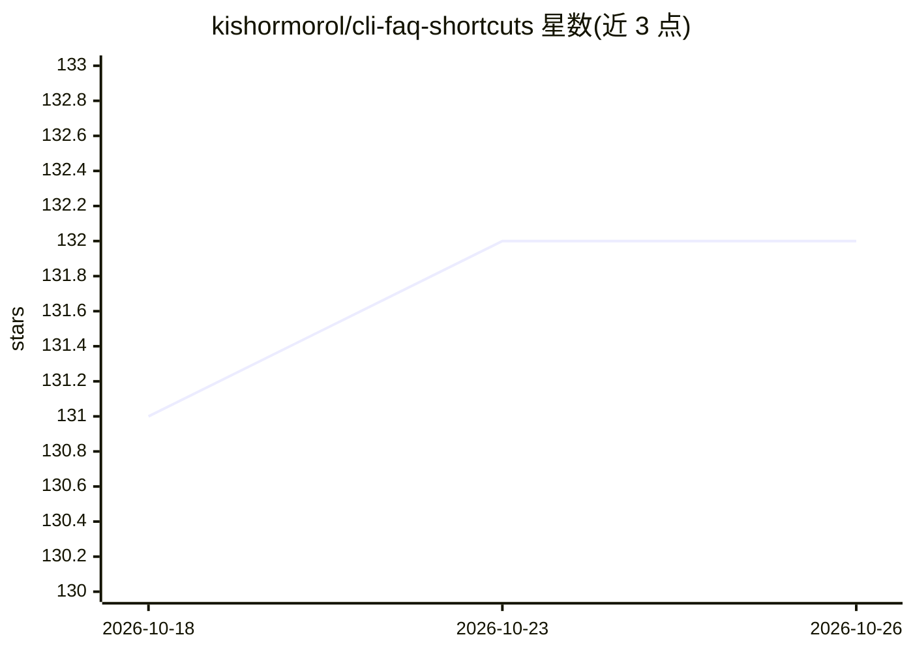

# kishormorol/cli-faq-shortcuts

⭐ 132 · Python · Apache-2.0 · 推送 2026-10-24 · [GitHub](https://github.com/kishormorol/cli-faq-shortcuts) · 个人维护

**把重复的编码 agent 提示词变成可复用斜杠命令的 Agent Skill**

一个安装到 Claude Code、Codex 和 Cursor 的 Agent Skill：本地 Python 脚本（仅标准库、无网络调用）读取三个工具的本机历史记录，提取你输入过的提示词；意图分组与聚类由用户的编码 agent 完成，最终生成 SKILL.md 形式的项目内斜杠命令（如 /sent）。快捷方式可提交到仓库供团队共享。限制：仅读取本机仍存留的历史，默认过滤 400 字符以上提示词，项目按文件夹精确匹配，Cursor 存储格式未文档化且可能变化。macOS/Linux/Windows 均通过 git clone 安装，也可作为 Claude Code 插件安装。

## 筛选速览

| 维度 | 判定 | 备注 |
|---|---|---|
| AI 角色 | `ai-ecosystem` | LLM/agent 周边工具 |
| 许可风险 | `permissive` | Apache-2.0 |
| 部署形态 | `None` |  |
| 模型依赖 | — | README 未给出锁定关系 |
| 硬件要求 | — | 无带数字的原话,不猜 |
| 安装摩擦 | `low` | 无编译、无系统依赖或容器化 |
| 成熟度 | — | 结构信号不足 |

## 能力要点

- 本地提取器仅用 Python 标准库，无需包、API key 或网络访问
- 支持读取 Claude Code、Codex、Cursor 三家的本机历史
- 生成 .claude/skills/<name>/SKILL.md 快捷方式并可提交供团队复用
- 写/发送类操作先 dry run 并等待用户确认

## 适用场景

- 把每天反复输入的长提示词变成一条斜杠命令
- 在团队仓库中共享项目常用操作快捷方式
- 统计自己最常重复的请求以发现可固化流程

## 场景标签

`提示工程` · 领域:Agent 开发

## 证据(README 行号)

> L9: **Stop typing the same long request to your coding agent every day.** This
> L90: 5. **Write.** Each chosen shortcut becomes a `SKILL.md` in `.claude/skills/`, linked into
> L101: |Claude Code|`~/.claude/skills/` (the link)|

## 星数曲线

2026-10-18 131 → 2026-10-26 132（+1）

---
*卡片 v1 · prompt 1.4 · 生成 2026-10-22 · 置信度 high · 依据 README sha `0e908b66f996` · [字段定义](../../DATASET.md)*
