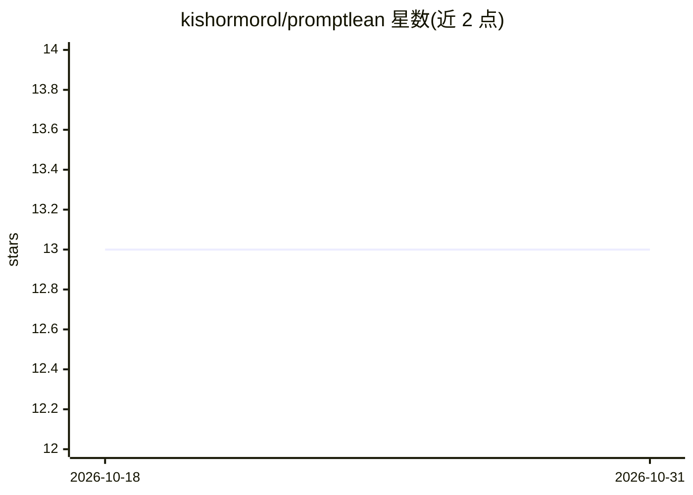

# kishormorol/promptlean

⭐ 13 · JavaScript · MIT · 推送 2026-09-18 · [GitHub](https://github.com/kishormorol/promptlean) · [官网](https://kishormorol.github.io/promptlean/) · 个人维护

**开源提示词库：120 条提示词、14 类，每条 3 个 token 档位变体**

面向开发者、创作者与教育者的提示词策展库：120 条提示词覆盖代码、数据、写作、研究、职业、心理健康等 14 类，每条提供 Lean/Balanced/Max Quality 三个 token 变体（Lean 平均节省 80–87% token），并为 8 个前沿模型附 1–5 分质量评分。站点含 Playground、变体 Diff、成本估算与社区变体机制；全部提示词可经 raw JSON 端点无鉴取用（CORS 全开）。静态站纯 HTML/JS，无构建步骤，本地以静态服务器运行。

## 筛选速览

| 维度 | 判定 | 备注 |
|---|---|---|
| AI 角色 | `ai-knowledge` | 知识聚合/清单类 |
| 许可风险 | `permissive` | MIT |
| 部署形态 | `None` |  |
| 模型依赖 | — | README 未给出锁定关系 |
| 硬件要求 | — | 无带数字的原话,不猜 |
| 安装摩擦 | `low` | 无编译、无系统依赖或容器化 |
| 成熟度 | — | 结构信号不足 |

## 能力要点

- 每条提示词 3 个 token 变体（Lean 18–40t / Balanced 50–110t / Max Quality 85–230t）
- 8 个前沿模型的 Model × Variant 质量评分矩阵与推荐变体
- 提示词可经 raw JSON 端点作为 API 使用，无需 key 与鉴权
- 社区变体机制：community/{id}.json 扩展额外变体页签

## 适用场景

- 高频 API 调用场景换用 Lean 变体节省 token 成本
- 按类别查找代码审查、研究总结、面试准备等任务的提示词
- 在自己的应用中通过 JSON 端点拉取提示词数据

## 场景标签

`提示工程` · 领域:Agent 开发

## 证据(README 行号)

> L19: PromptLean is a curated, open-source library of 120 prompts across 14 categories — from code review and SQL optimiz
> L21: The key idea: **most prompts are overengineered**. You don't need 200 tokens of preamble for a code review. But som
> L53: ### Use as an API

## 星数曲线

2026-10-18 13 → 2026-10-31 13（+0）

---
*卡片 v1 · prompt 1.4 · 生成 2026-10-31 · 置信度 high · 依据 README sha `6153dca3855c` · [字段定义](../../DATASET.md)*
