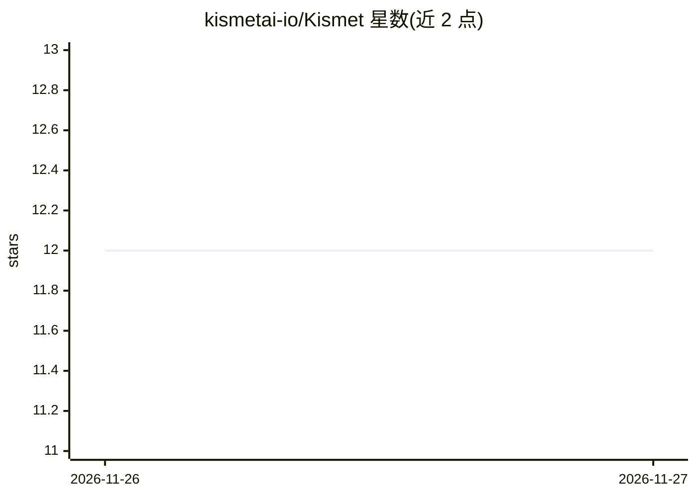

# kismetai-io/Kismet

⭐ 12 · C++ · Apache-2.0 · 推送 2026-11-25 · [GitHub](https://github.com/kismetai-io/Kismet) · [官网](https://kismetai.io) · 组织维护

**在 Unreal 编辑器内读写并编译蓝图等资产的 AI agent 与 MCP server**

以 UE 插件形式运行的 AI agent：在编辑器内编辑 Blueprint、Animation Blueprint、Material 与 UMG widget，并用编译器校验改动。支持接入用户自选的模型提供商（Anthropic、OpenAI、Google、DeepSeek、Z.ai、Moonshot、MiniMax、OpenRouter，或经 Ollama/LM Studio 接本地模型），无需注册 Kismet 账号。内置本地 MCP server（127.0.0.1:8323，仅限本机，Bearer token 认证），Claude Code、Codex、Cursor 等 MCP 客户端可调用同一套工具；MCP 写操作需编辑器控制台按文件夹授权。支持 UE 5.6–5.9，macOS（Apple Silicon）与 Windows，提供现成二进制与源码两种发行形式。

## 筛选速览

| 维度 | 判定 | 备注 |
|---|---|---|
| AI 角色 | `ai-native` | 本体是模型或模型工具 |
| 许可风险 | `permissive` | Apache-2.0 |
| 部署形态 | `None` |  |
| 模型依赖 | local-ok | 支持本地模型 |
| 硬件要求 | — | 无带数字的原话,不猜 |
| 安装摩擦 | `low` | 无编译、无系统依赖或容器化 |
| 成熟度 | — | 结构信号不足 |

## 能力要点

- 编辑 Blueprint、Animation Blueprint、Material 与 UMG widget 并以编译器校验结果
- 内置本地 MCP server，供 Claude Code/Codex/Cursor 等客户端复用工具
- 支持多家云端模型提供商及 Ollama/LM Studio 本地模型
- 提供 ready-to-run 二进制与源码两种发行形式，Apache-2.0 许可

## 适用场景

- 让 AI 在 UE 编辑器里代为搭建和修改蓝图逻辑
- 用 Claude Code/Cursor 等客户端通过 MCP 操作引擎资产
- 接入自建或本地模型驱动游戏资产编辑流程

## 场景标签

`编码 Agent` · 领域:编码与开发

## 证据(README 行号)

> L5: An open-source AI agent for Unreal Engine. Kismet runs inside the editor and
> L30: Kismet is also a Model Context Protocol

## 星数曲线

2026-11-26 12 → 2026-11-27 12（+0）

---
*卡片 v1 · prompt 1.4 · 生成 2026-11-26 · 置信度 high · 依据 README sha `b30f201bf39f` · [字段定义](../../DATASET.md)*
