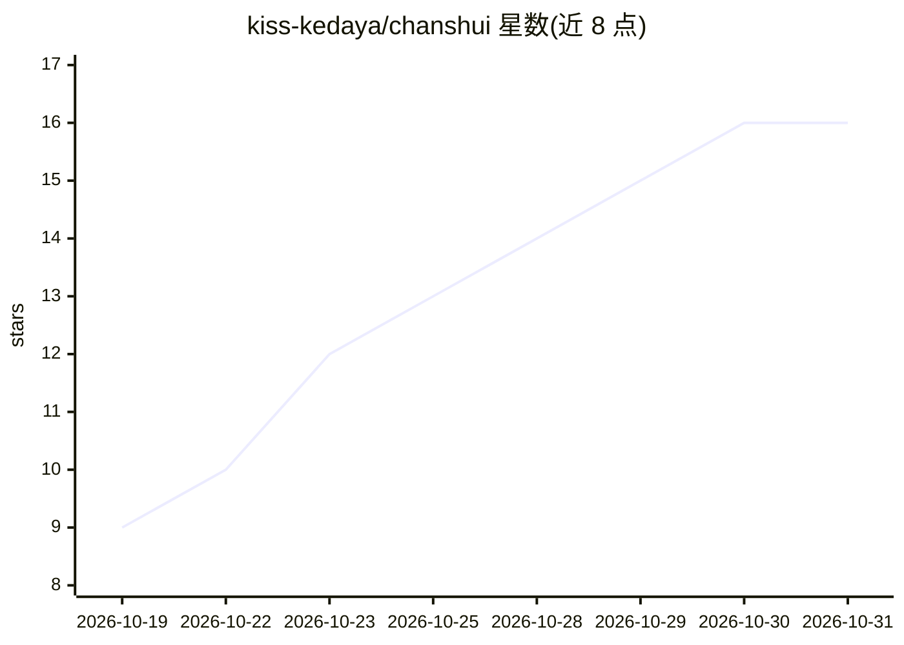

# kiss-kedaya/chanshui

⭐ 16 · Go · MIT · 推送 2026-10-20 · [GitHub](https://github.com/kiss-kedaya/chanshui) · [官网](https://chanshui.dev) · 个人维护 · 中文 README

**自托管 LLM 网关审计站：核验声称模型是否真实提供**

面向自托管场景的模型中转站审计工具：填入网关地址、API Key 与模型名，提交检测后生成带证据链的报告。检测覆盖模型指纹归因（数字挑战+行为参考）、注入大小估算、缓存读写、工具调用、联网证据、思维链回传、知识截止与推理题评分，未知项显示未知而不伪判。架构为单个 Go 二进制托管 Next.js 静态前端与 API，SQLite 存储，单机可运行；提供 Docker Compose 与 systemd/nginx 部署模板，API Key 不落盘，报告默认 24 小时过期。

## 筛选速览

| 维度 | 判定 | 备注 |
|---|---|---|
| AI 角色 | `ai-ecosystem` | LLM/agent 周边工具 |
| 许可风险 | `permissive` | MIT |
| 部署形态 | `self-host` | docker 或自建部署 |
| 模型依赖 | — | README 未给出锁定关系 |
| 硬件要求 | — | 无带数字的原话,不猜 |
| 安装摩擦 | `low` | 无编译、无系统依赖或容器化 |
| 成熟度 | — | 结构信号不足 |

## 能力要点

- 数字挑战+行为参考的模型指纹归因，证据不足时明确标注不伪造结论
- 缓存/工具/联网/思维链/知识截止等独立板块化检测与覆盖率统计
- 单 Go 二进制 + Next.js 静态前端 + SQLite，单机运行
- 提供面向 Agent/脚本的公共 API 与 OpenAPI 文档

## 适用场景

- 核验中转商声称的模型是否被真实提供
- 审计网关的缓存、工具调用与联网能力
- 采集模型指纹基线做候选归因对比

## 场景标签

`模型评测` · 领域:评测与运维

## 证据(README 行号)

> L3: > Self-hosted audit station for LLM gateways and resellers. Check whether a claimed model is actually served, and co
> L5: 一个可自托管的模型中转站审计工具。填入网关地址、API Key 和模型名，提交一次检测，得到一份带证据链的报告。Go 服务端 + Next.js 静态前端 + SQLite，单机即可运行。

## 星数曲线

2026-10-19 9 → 2026-10-31 16（+7）

---
*卡片 v1 · prompt 1.4 · 生成 2026-10-30 · 置信度 high · 依据 README sha `0240b46d6cc0` · [字段定义](../../DATASET.md)*
