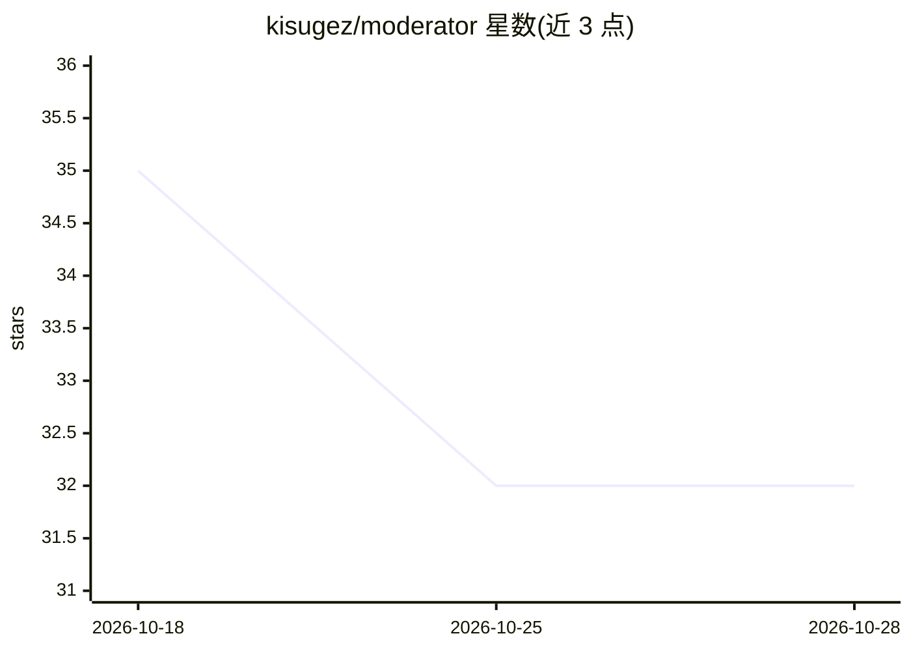

# kisugez/moderator

⭐ 32 · Python · MIT · 推送 2026-06-12 · [GitHub](https://github.com/kisugez/moderator) · 个人维护

**BYOK 内容审核 API：自带 AI key，审消息并跟踪违规用户**

基于 FastAPI + PostgreSQL 的内容审核微服务：应用通过 POST /moderate 提交用户消息，服务调用用户自行提供 key 的 AI 供应商（Claude/GPT-4o/Gemini）返回违规判定，并按 5 次记录的 strike 流水线跟踪重复违规者，第 5 次后永久标记并跳过推理调用。API key 经 Fernet 加密存储，认证用 JWT + 服务端会话表；提供管理员违规日志与解封接口、交互式 CLI 及 pytest 测试。通过 git clone 与 docker compose 部署。

## 筛选速览

| 维度 | 判定 | 备注 |
|---|---|---|
| AI 角色 | `ai-native` | 本体是模型或模型工具 |
| 许可风险 | `permissive` | MIT |
| 部署形态 | `self-host` | docker 或自建部署 |
| 模型依赖 | locked-api |  |
| 硬件要求 | — | 无带数字的原话,不猜 |
| 安装摩擦 | `low` | 无编译、无系统依赖或容器化 |
| 成熟度 | — | 结构信号不足 |

## 能力要点

- 三供应商（Claude/GPT-4o/Gemini）经统一 AIProvider 抽象接入，BYOK 模式 key 经 Fernet 加密存储
- 5-strike 流水线：永久标记用户后不再调用推理
- JWT + 服务端会话哈希表，登出即物理吊销令牌
- 附带终端 CLI 与 pytest 测试（本地/容器集成）

## 适用场景

- 给我的应用接入 AI 内容审核而不托管 API key
- 跨应用持续跟踪重复违规用户并自动封禁
- 管理员查询违规日志、重置用户 strike 记录

## 场景标签

 · 领域:内容审核/后端服务

## 证据(README 行号)

> L8: #### BYOK AI content moderation microservice. Bring your own API key, plug it in, get a verdict on every message. Th
> L25: Any app sends `POST /moderate` with a user ID and message. The service runs it through your connected AI provider (

## 星数曲线

2026-10-18 35 → 2026-10-28 32（-3）

---
*卡片 v1 · prompt 1.4 · 生成 2026-10-26 · 置信度 high · 依据 README sha `a0e6f07277fb` · [字段定义](../../DATASET.md)*
