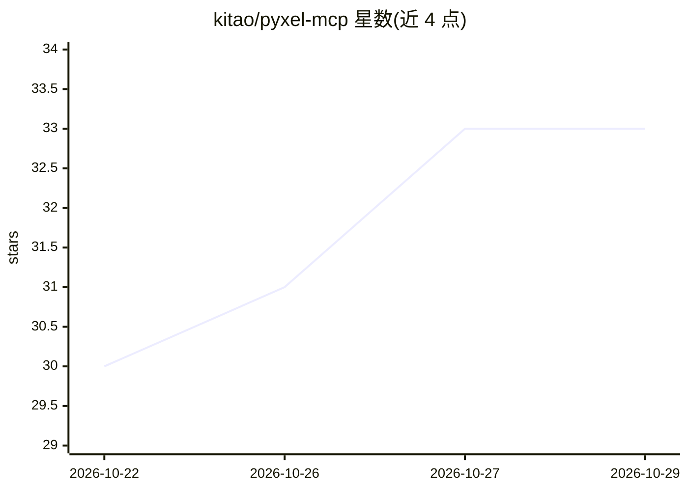

# kitao/pyxel-mcp

⭐ 33 · Python · MIT · 推送 2026-10-23 · [GitHub](https://github.com/kitao/pyxel-mcp) · [官网](https://github.com/kitao/pyxel) · 个人维护

**让 AI agent 无头运行并观察 Pyxel 复古游戏的 MCP 服务器**

面向 AI agent 辅助复古游戏开发的 MCP server：以 stdio 方式注册到 Claude Code、Codex、Gemini CLI、Cursor、VS Code 等客户端。核心机制是 headless 执行——在子进程中用 SDL dummy 驱动运行 Pyxel 脚本，按帧调度按钮/轴/鼠标输入，条件满足（如 score>=1）即停，并返回截图、像素网格、游戏状态、音频与帧差等结构化事实；PNG 可作为 MCP image content 内联返回。提供 validate、run、read_palette、read_image、read_tilemap、read_audio、diff_frames 等 8 个工具。工具不做不可信代码沙箱，需 Python 3.11+ 与 Pyxel >= 2.9.6。

## 筛选速览

| 维度 | 判定 | 备注 |
|---|---|---|
| AI 角色 | `ai-ecosystem` | LLM/agent 周边工具 |
| 许可风险 | `permissive` | MIT |
| 部署形态 | `library` | 以包/库形式分发 |
| 模型依赖 | — | README 未给出锁定关系 |
| 硬件要求 | — | 无带数字的原话,不猜 |
| 安装摩擦 | `low` | 无编译、无系统依赖或容器化 |
| 成熟度 | — | 结构信号不足 |

## 能力要点

- headless 子进程执行 Pyxel 脚本，带帧预算与随机种子设置
- 输入按帧调度为 JSON 文档，playtest 可重放和扩展
- until 条件停止 + 多种快照（state/screen_image/screen_grid/video）
- 8 个工具，全部声明输入输出 schema，结果含 ok 与 errors

## 适用场景

- 让 AI agent 编写 Pyxel 游戏后自动运行验证并查看画面
- 按帧调度输入做自动化游戏测试，观察像素/状态变化
- 读取 Pyxel 素材（调色板、图像库、tilemap、音频）做检查

## 场景标签

 · 领域:游戏开发/AI 工具链

## 证据(README 行号)

> L3: **Let AI agents play, watch, and measure Pyxel games.** pyxel-mcp is an MCP server that runs a Pyxel script headless
> L18: An agent can write a Pyxel game in seconds, but it cannot open a window, press the arrow keys, or look at the scree
> L62: [pyxel-mcp] starting - 8 tools

## 星数曲线

2026-10-22 30 → 2026-10-29 33（+3）

---
*卡片 v1 · prompt 1.4 · 生成 2026-10-26 · 置信度 high · 依据 README sha `3bc895809103` · [字段定义](../../DATASET.md)*
