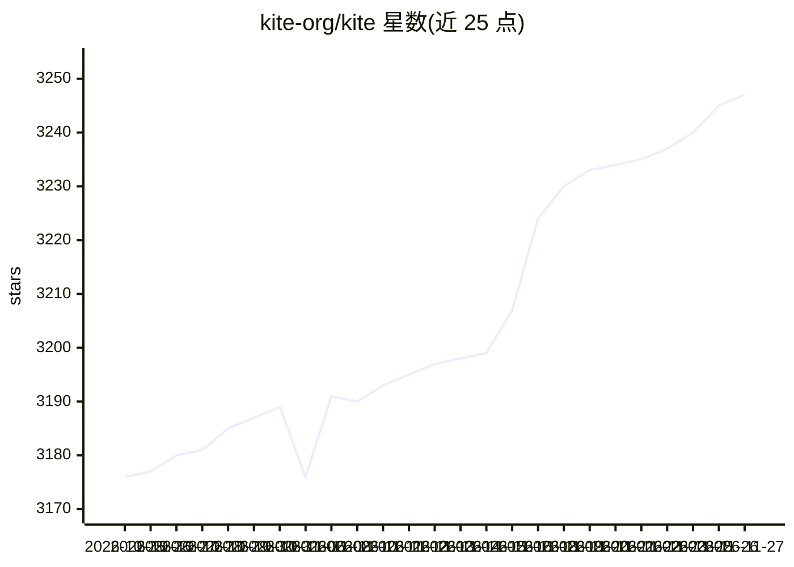

# kite-org/kite

⭐ 3,247 · TypeScript · Apache-2.0 · 推送 2026-11-25 · [GitHub](https://github.com/kite-org/kite) · [官网](https://kitehq.dev/) · 个人维护 · 中文 README

**给运维的多集群 Kubernetes 工作台，含 AI 辅助排障**

面向多集群 Kubernetes 运维的开源工作台，功能覆盖监控（Prometheus 集成）、资源与 Helm release 管理、浏览器内 kubectl 终端、OAuth/LDAP/MFA 认证与 RBAC 审计。AI 部分为内置助手，可检查资源、日志与指标，写操作需人工确认且遵循当前用户 RBAC 权限。提供 macOS/Windows 桌面版（Beta）读取本地 kubeconfig，以及 Helm、Docker、Manifest、源码构建多种部署方式。

## 筛选速览

| 维度 | 判定 | 备注 |
|---|---|---|
| AI 角色 | `ai-enhanced` | 去掉 AI 部分产品仍成立 |
| 许可风险 | `permissive` | Apache-2.0 |
| 部署形态 | `self-host` | docker 或自建部署 |
| 模型依赖 | — | README 未给出锁定关系 |
| 硬件要求 | — | 无带数字的原话,不猜 |
| 安装摩擦 | `low` | 无编译、无系统依赖或容器化 |
| 成熟度 | — | 结构信号不足 |

## 能力要点

- 多集群资源、CRD 与 Helm release 集中管理
- 内置 AI 助手检查资源/日志/Prometheus 指标，写操作需确认且遵循 RBAC
- OAuth、LDAP、本地账户、MFA、passkey 登录与审计日志
- 桌面版（macOS DMG/Windows 安装器/Homebrew）与服务器部署双形态

## 适用场景

- 在单一界面统一管理多个 Kubernetes 集群与 Helm 应用
- 通过对话让 AI 助手辅助排查集群与 Pod 问题
- 团队场景下按 RBAC 分配集群访问权限并留存审计日志

## 场景标签

 · 领域:云原生/运维工具

## 证据(README 行号)

> L7: Kite is a lightweight, open-source Kubernetes workspace for multi-cluster operations, observability, access control,
> L42: - Inspect resources, logs, and Prometheus metrics with the built-in AI assistant.
> L49: Manage your clusters with local kubeconfig files on macOS and Windows, without deploying a Kite server.

## 星数曲线

2026-10-25 3,176 → 2026-11-27 3,247（+71）

---
*卡片 v1 · prompt 1.4 · 生成 2026-11-23 · 置信度 high · 依据 README sha `5db9d7d5c5b9` · [字段定义](../../DATASET.md)*
