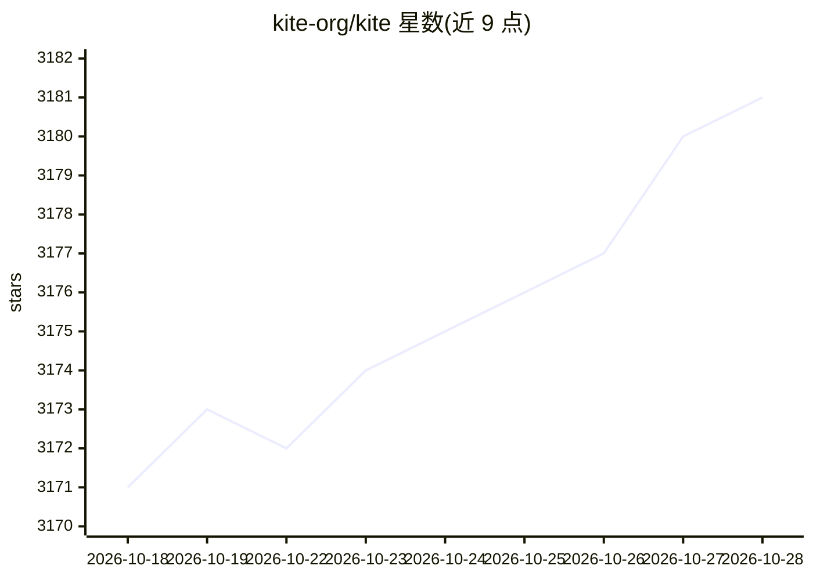

# kite-org/kite

⭐ 3,181 · TypeScript · Apache-2.0 · 推送 2026-10-25 · [GitHub](https://github.com/kite-org/kite) · [官网](https://kitehq.dev/) · 组织维护 · 中文 README

**多集群 Kubernetes 工作台，含 AI 辅助排障**

开源的轻量级 Kubernetes 多集群工作台，提供资源管理、CRD 与 Helm 发布管理、实时 YAML 编辑、浏览器终端、Kube Proxy 访问、Prometheus 监控（CPU/内存/网络）、日志流式查看与过滤，以及 OAuth/LDAP/MFA/通行密钥登录和 RBAC 权限控制。内置 AI 助手可检查资源、日志与指标并辅助排障，写操作需用户确认且受当前用户 RBAC 权限约束。安装方式含 Helm、Docker、Kubernetes Manifest 与源码构建；默认配置面向评估用途，生产需配置持久化存储与外部数据库。

## 筛选速览

| 维度 | 判定 | 备注 |
|---|---|---|
| AI 角色 | `ai-enhanced` | 去掉 AI 部分产品仍成立 |
| 许可风险 | `permissive` | Apache-2.0 |
| 部署形态 | `self-host` | docker 或自建部署 |
| 模型依赖 | — | README 未给出锁定关系 |
| 硬件要求 | — | 无带数字的原话,不猜 |
| 安装摩擦 | `low` | 无编译、无系统依赖或容器化 |
| 成熟度 | — | 结构信号不足 |

## 能力要点

- 多集群资源/Helm/CRD 管理与浏览器终端
- 内置 AI 助手检查资源、日志与 Prometheus 指标，写操作需确认且受 RBAC 约束
- OAuth/LDAP/MFA/通行密钥登录与审计日志
- Helm/Docker/Manifest/源码多种安装方式

## 适用场景

- 在一个界面统一管理多个 Kubernetes 集群的资源与 Helm 发布
- 通过 AI 助手分析日志、事件与指标定位集群问题
- 为团队配置带 RBAC 与审计的多用户集群访问

## 场景标签

 · 领域:云原生/Kubernetes 运维

## 证据(README 行号)

> L7: Kite is a lightweight, open-source Kubernetes workspace for multi-cluster operations, observability, access control,
> L40: - Inspect resources, logs, and Prometheus metrics with the built-in AI assistant.

## 星数曲线

2026-10-18 3,171 → 2026-10-28 3,181（+10）

---
*卡片 v1 · prompt 1.4 · 生成 2026-10-20 · 置信度 high · 依据 README sha `f4bd92d53ae8` · [字段定义](../../DATASET.md)*
