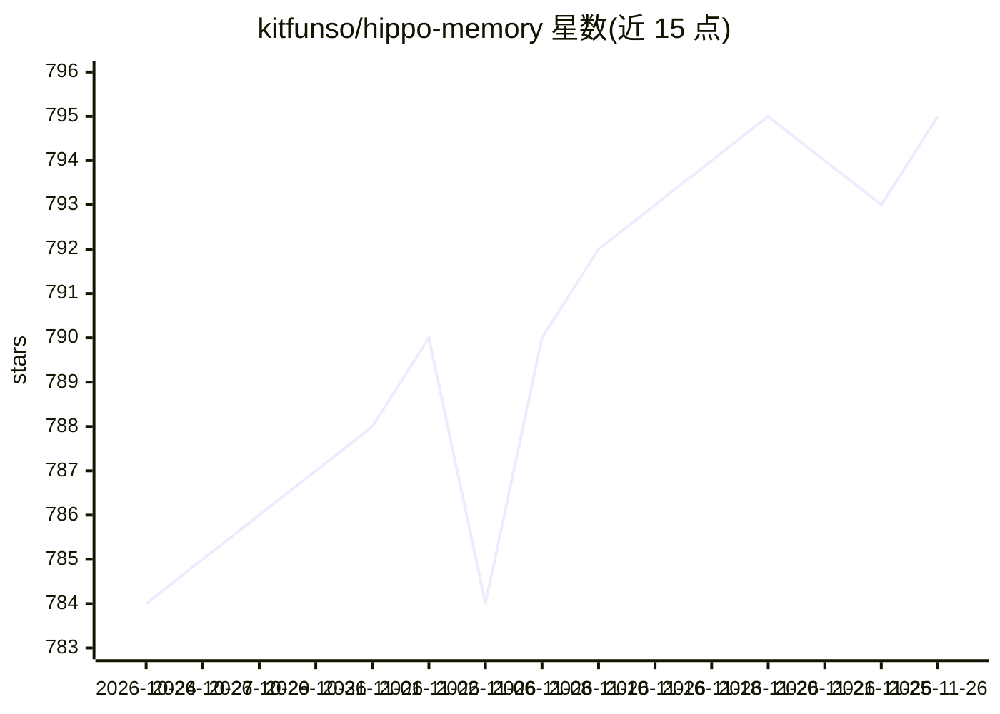

# kitfunso/hippo-memory

⭐ 795 · TypeScript · MIT · 推送 2026-11-25 · [GitHub](https://github.com/kitfunso/hippo-memory) · [官网](https://hippo-memory.com) · 个人维护

**给编码 Agent 共享本地记忆库：一次教会，多端复用**

面向编码 Agent 的本地记忆管理工具：把你在某个 Agent（Claude Code、Codex、Cursor 等）会话中纠正过的规则与教训写入项目内的 .hippo/ 存储（SQLite + 可提交的 markdown 镜像），其他 Agent 通过 hooks、插件、扩展或 MCP 读取同一存储。默认路径零模型调用，检索用关键词加本地 Transformers.js 嵌入；支持记忆衰减、supersede 替换、outcome 反馈弱化、从 git 提交学习与导入既有笔记。依赖 Node.js 22.16+，无运行时依赖，通过 npm 安装。

## 筛选速览

| 维度 | 判定 | 备注 |
|---|---|---|
| AI 角色 | `ai-ecosystem` | LLM/agent 周边工具 |
| 许可风险 | `permissive` | MIT |
| 部署形态 | `library` | 以包/库形式分发 |
| 模型依赖 | — | README 未给出锁定关系 |
| 硬件要求 | — | 无带数字的原话,不猜 |
| 安装摩擦 | `low` | 无编译、无系统依赖或容器化 |
| 成熟度 | — | 结构信号不足 |

## 能力要点

- 多 Agent 共享一个存储：hooks/插件/MCP 服务器三种接入方式
- 默认路径零 LLM 调用存储记忆，检索无网络请求
- 记忆机制：衰减、pinned、supersede、outcome 弱化
- markdown 镜像可 grep、diff、提交进 git

## 适用场景

- 在 Claude Code 里教过的规则，切换到 Cursor 或 Codex 时不用重教
- 团队把记忆 markdown 提交进仓库，在 PR 里评审编码规则
- 团队通过共享服务器让成员使用同一份 Agent 记忆

## 场景标签

`Agent 记忆` · 领域:Agent 开发

## 证据(README 行号)

> L16: Works with:    Claude Code, Codex, Cursor, Pi, OpenClaw, OpenCode, any MCP client
> L154: |Any MCP client|`hippo mcp`, 13 tools|

## 星数曲线

2026-10-24 784 → 2026-11-26 795（+11）

---
*卡片 v1 · prompt 1.4 · 生成 2026-11-26 · 置信度 high · 依据 README sha `1fcfecd1b95b` · [字段定义](../../DATASET.md)*
