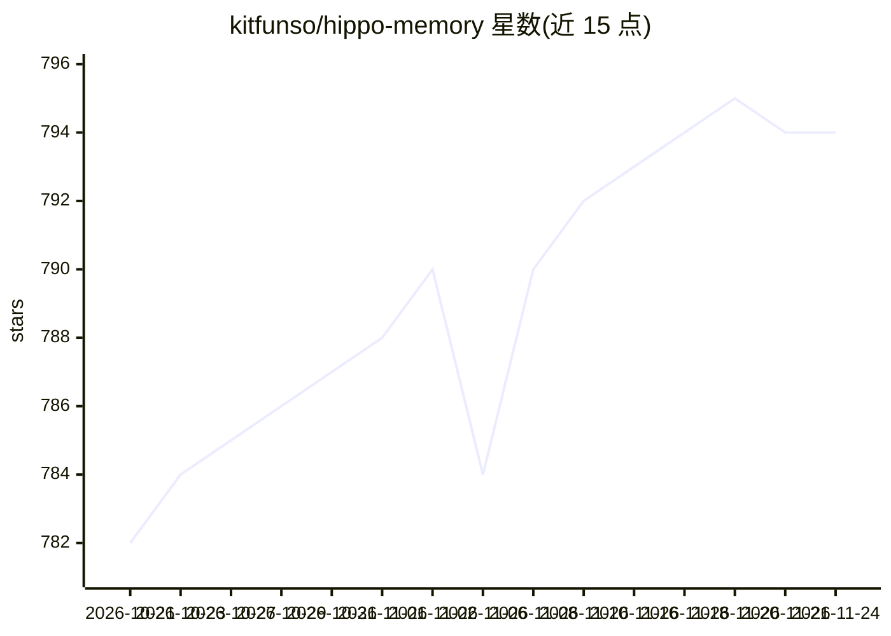

# kitfunso/hippo-memory

⭐ 794 · TypeScript · MIT · 推送 2026-11-22 · [GitHub](https://github.com/kitfunso/hippo-memory) · [官网](https://hippo-memory.com) · 个人维护

**为编码 agent 提供跨工具共享的本地记忆存储**

以 npm 包形式安装的记忆层：hippo init 在项目内创建 .hippo/ SQLite 存储（附可提交的 markdown 镜像），通过 Claude Code/Codex 等 hook 在会话结束时捕获用户纠正的规则与错误，下次会话前注入；支持关键词召回（默认零模型调用）、基于本地 Transformers.js 嵌入的语义召回、`hippo outcome --bad` 弱化错误记忆、supersede 替换与按时间衰减。同一存储可被多个 agent（Claude Code、Codex、Cursor、Gemini CLI、任意 MCP 客户端等）读取，并提供 MCP server（13 个工具）、本地 dashboard、git 历史学习与跨工具导入。

## 筛选速览

| 维度 | 判定 | 备注 |
|---|---|---|
| AI 角色 | `ai-ecosystem` | LLM/agent 周边工具 |
| 许可风险 | `permissive` | MIT |
| 部署形态 | `library` | 以包/库形式分发 |
| 模型依赖 | — | README 未给出锁定关系 |
| 硬件要求 | — | 无带数字的原话,不猜 |
| 安装摩擦 | `low` | 无编译、无系统依赖或容器化 |
| 成熟度 | — | 结构信号不足 |

## 能力要点

- 多 agent 共享一个本地存储：Claude Code/Codex/Cursor/Gemini CLI/MCP 客户端均可接入
- 默认路径存储记忆零 LLM 调用；嵌入用本地 Transformers.js（约 480 MB，可跳过）
- 记忆衰减、pinned 固定、outcome 反馈弱化与 supersede 版本替换机制
- markdown 镜像可 grep、commit 并在 PR 中评审

## 适用场景

- 在多个编码 agent 间切换时不丢失教过的规则与教训
- 把团队的 agent 记忆以 markdown 形式提交进仓库共同评审
- 减少 Claude Code 会话中重复犯同类错误

## 场景标签

`Agent 记忆` · 领域:Agent 开发

## 证据(README 行号)

> L16: Works with:    Claude Code, Codex, Cursor, Pi, OpenClaw, OpenCode, any MCP client
> L18: Storage:       SQLite with markdown mirrors you can read and commit
> L134: |Any MCP client|`hippo mcp`, 13 tools|

## 星数曲线

2026-10-21 782 → 2026-11-24 794（+12）

---
*卡片 v1 · prompt 1.4 · 生成 2026-11-24 · 置信度 high · 依据 README sha `5604aaa1bcf7` · [字段定义](../../DATASET.md)*
