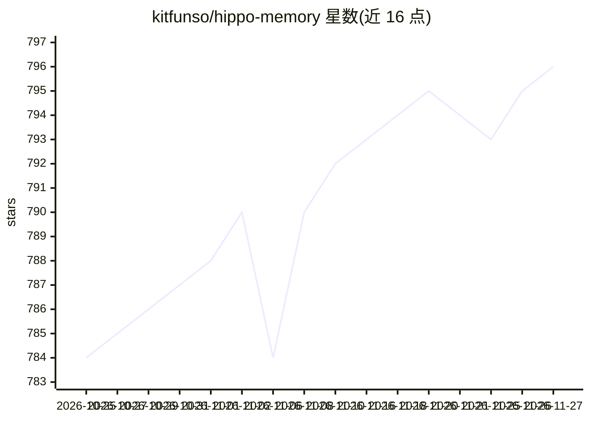

# kitfunso/hippo-memory

⭐ 796 · TypeScript · MIT · 推送 2026-11-26 · [GitHub](https://github.com/kitfunso/hippo-memory) · [官网](https://hippo-memory.com) · 个人维护

**为多个编码 agent 提供共享本地记忆存储的工具**

在仓库内创建 .hippo/ 存储（SQLite 加 markdown 镜像），把用户教给某一个编码 agent 的规则与教训写入该存储，其余 agent 读取同一存储。支持 Claude Code、Codex、Cursor、Gemini CLI 等及任意 MCP 客户端，可从 ChatGPT、CLAUDE.md、.cursorrules、Slack 导入。默认路径存储记忆时零模型调用，召回用关键词与本地嵌入混合检索；hippo sleep 在设置 ANTHROPIC_API_KEY 时调用模型，也可通过 HIPPO_LLM_BASE_URL 指向 OpenAI 兼容端点。需 Node.js 22.16+，零运行时依赖。

## 筛选速览

| 维度 | 判定 | 备注 |
|---|---|---|
| AI 角色 | `ai-ecosystem` | LLM/agent 周边工具 |
| 许可风险 | `permissive` | MIT |
| 部署形态 | `library` | 以包/库形式分发 |
| 模型依赖 | — | README 未给出锁定关系 |
| 硬件要求 | — | 无带数字的原话,不猜 |
| 安装摩擦 | `low` | 无编译、无系统依赖或容器化 |
| 成熟度 | — | 结构信号不足 |

## 能力要点

- 多 agent 共享一个记忆存储（SQLite + 可提交的 markdown 镜像）
- 默认存储路径零 LLM 调用，关键词召回无模型与网络调用
- 记忆衰减/固定/替代机制：unused 渐弱、pinned 不衰减、hippo supersede 替换
- 可从 ChatGPT/Claude/Cursor/Slack/markdown 导入既有笔记

## 适用场景

- 在 Claude Code 与 Cursor 等多个编码 agent 间共享项目规则记忆
- 把团队编码规范以 markdown 形式提交并进行 PR 评审
- 通过团队服务器让多人读取同一记忆存储

## 场景标签

`Agent 记忆` · 领域:Agent 开发

## 证据(README 行号)

> L5: Inspired by the human hippocampus, hippo saves what you teach one coding agent in your repo, and your other agents r
> L16: Works with:    Claude Code, Codex, Cursor, Pi, OpenClaw, OpenCode, Junie, Antigravity, Grok Build,
> L160: |Any MCP client|`hippo mcp`, 13 tools|

## 星数曲线

2026-10-25 784 → 2026-11-27 796（+12）

---
*卡片 v1 · prompt 1.4 · 生成 2026-11-27 · 置信度 high · 依据 README sha `63bda57ef73b` · [字段定义](../../DATASET.md)*
