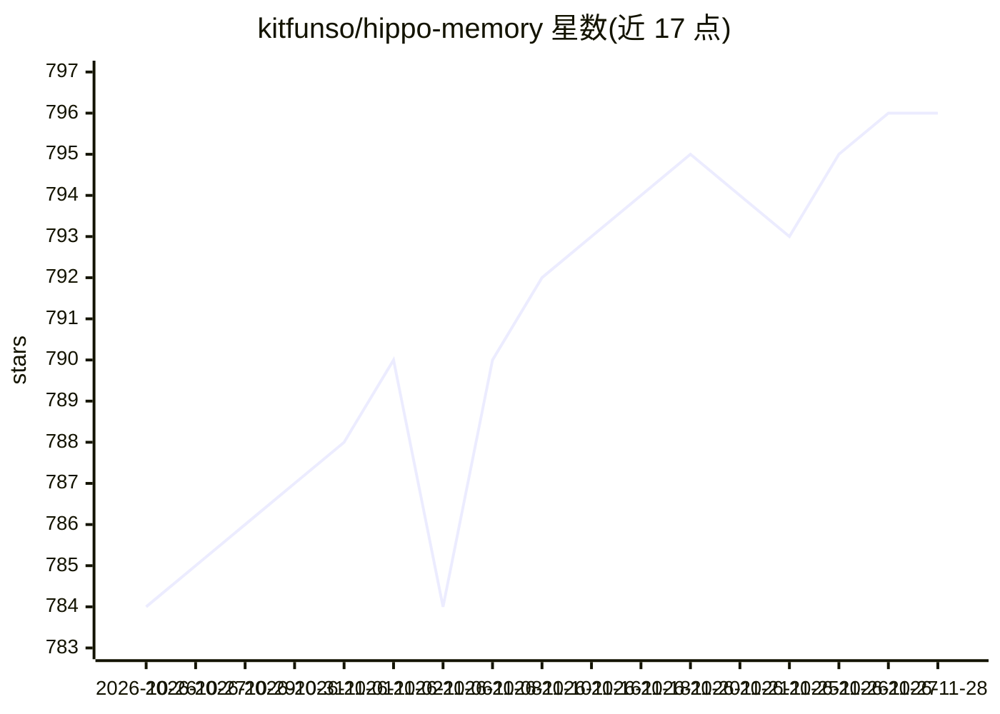

# kitfunso/hippo-memory

⭐ 796 · TypeScript · MIT · 推送 2026-11-27 · [GitHub](https://github.com/kitfunso/hippo-memory) · [官网](https://hippo-memory.com) · 个人维护

**为多个编码 Agent 提供仓库内共享的本地记忆存储**

以 npm 包形式分发的编码 Agent 记忆工具：把你在某个 Agent 会话中教过的规则与教训写入项目内 `.hippo/` 存储（SQLite 加可提交的 markdown 镜像），其他 Agent 从同一存储读取。默认路径存储零模型调用，检索用关键词加本地 Transformers.js 嵌入；支持记忆衰减、`--bad` 弱化错误记忆、supersede 替换旧事实、每日定时从 git 提交学习。`hippo init` 同时写入 hooks/规则块并安装嵌入器，`--no-hooks` 等可逐项跳过。计划提供含 SSO 等的商业版。

## 筛选速览

| 维度 | 判定 | 备注 |
|---|---|---|
| AI 角色 | `ai-ecosystem` | LLM/agent 周边工具 |
| 许可风险 | `permissive` | MIT |
| 部署形态 | `library` | 以包/库形式分发 |
| 模型依赖 | — | README 未给出锁定关系 |
| 硬件要求 | — | 无带数字的原话,不猜 |
| 安装摩擦 | `low` | 无编译、无系统依赖或容器化 |
| 成熟度 | — | 结构信号不足 |

## 能力要点

- 多 Agent 共享一个记忆存储，支持 Claude Code、Codex、Cursor、任意 MCP 客户端等
- 默认路径存储一条记忆零 LLM 调用，检索无模型无网络
- 记忆带衰减与结果反馈：错误记忆被弱化，pinned 不衰减
- markdown 镜像可读、可 diff、可提交与评审

## 适用场景

- 在多个编码 Agent 之间切换时保留同一套项目规则与教训
- 团队把 Agent 规则以 markdown 提交并在 PR 中评审
- 从 git 历史自动沉淀项目的踩坑经验

## 场景标签

`Agent 记忆` `编码 Agent` · 领域:Agent 开发

## 证据(README 行号)

> L16: Works with:    Claude Code, Codex, Cursor, Pi, OpenClaw, OpenCode, Hermes Agent, Junie,
> L44: `hippo init` creates a `.hippo/` store in the project, adds a short block to an existing `CLAUDE.md` or `AGENTS.md`

## 星数曲线

2026-10-26 784 → 2026-11-28 796（+12）

---
*卡片 v1 · prompt 1.4 · 生成 2026-11-28 · 置信度 high · 依据 README sha `08a6b5d02455` · [字段定义](../../DATASET.md)*
